# Day 7: Some Assembly Required

https://adventofcode.com/2015/day/7

**Part 1:** the input describes a circuit of wires joined by 16-bit gates (AND, OR, NOT and left and right shifts), each wire getting its signal from a constant or from other wires; find the signal on wire `a`.

**Part 2:** take the signal of `a` from part 1, give it to wire `b` instead of its own source, and find the new signal on `a`.

Every wire is a point that stores its sources and its gate. A repeat zone computes, in each iteration, every wire whose sources already have a value, until all of them do. The visualization rebuilds the circuit as gates and wires and moves along it in the order the wires are computed. Some wires still overlap.

  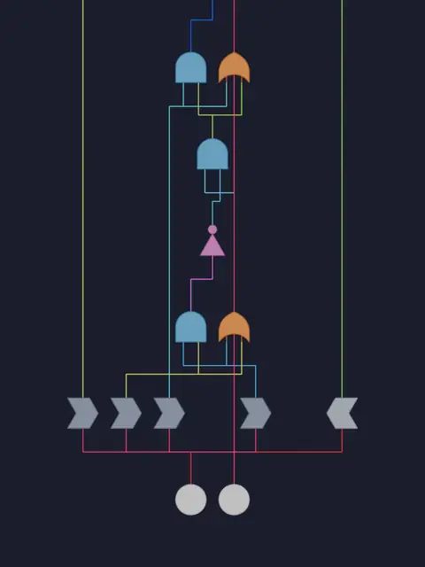 
  <em>Part 1</em>

  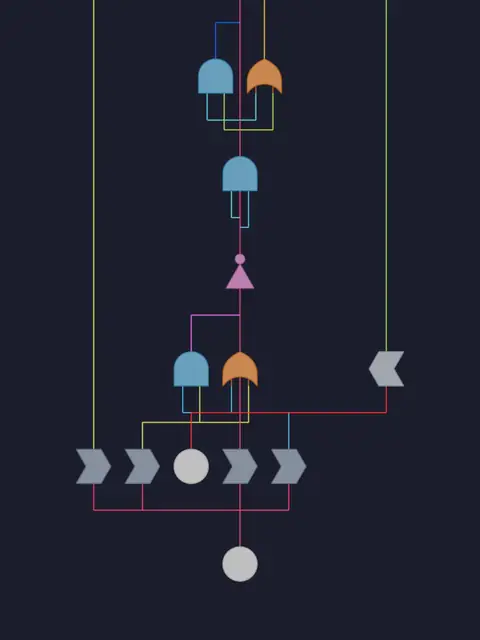 
  <em>Part 2</em>

## Notes

- Paste the input into the "Puzzle Input" node and choose the part with the "Part" menu in the modifier.
- For part 2, write the part 1 answer in the "P1 Solution" node of the "P2" frame.
- Press Bake in the Bake node (Still) after changing the input or the part, before playing the animation.
- The answer is in the Viewer of the "P1 / P2 Result" frame: the value of wire `a`.
- The gates are objects in the "Gates" collection, instanced by their operator.

## Solution

The main tree turns the input into points, computes every wire in Process Connections, bakes the result and builds the circuit from it.

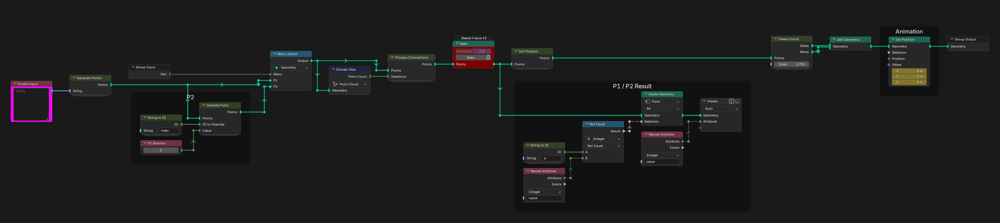

Generate Points makes one point per line of the input, with its sources, its gate and its own name.

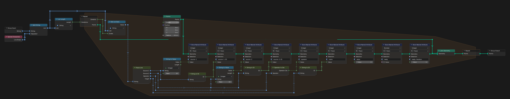

Parse Line splits a line into its sources, its gate and its target wire.

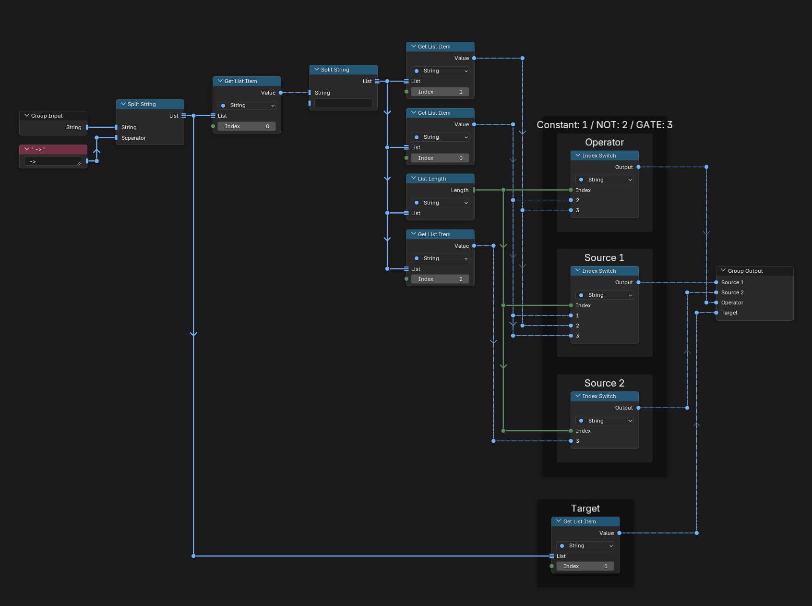

Operator to Idx turns the gate name into a number.

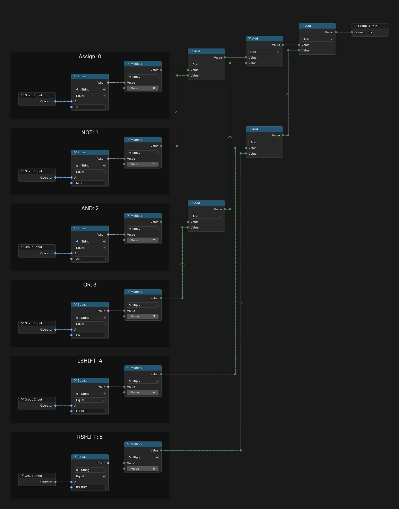

String to ID turns a wire name into a number, or -1 when it is a constant. Blender cannot store strings in named attributes, so every wire is identified by this number instead of its name: each letter's position in the alphabet, as digits of a base-100 number.

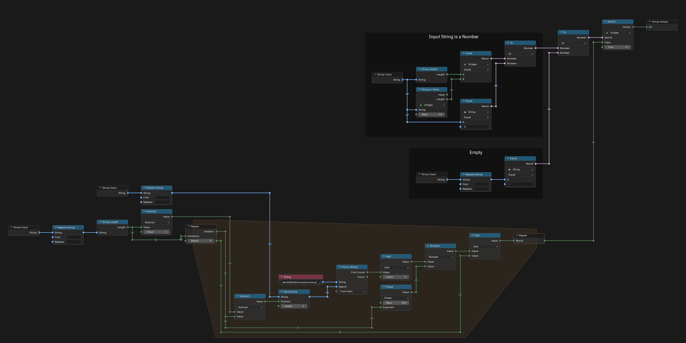

Override Point replaces the source of a wire with a value, for part 2.

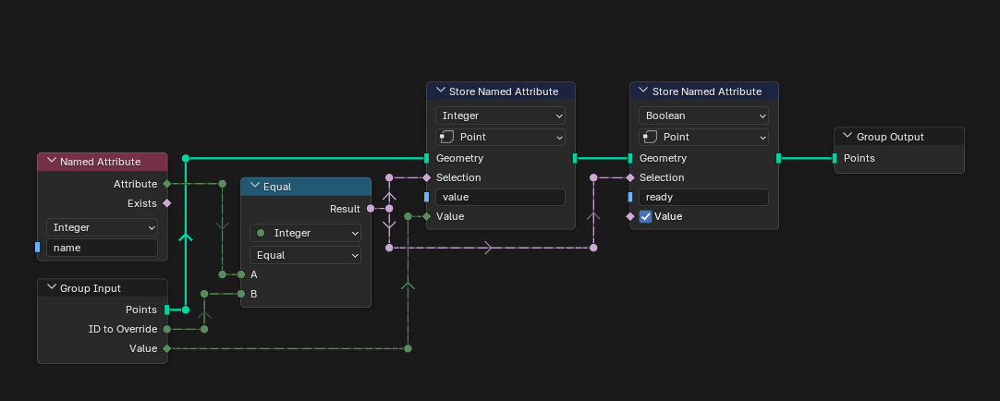

Process Connections is the repeat zone: in each iteration it computes the wires whose sources are ready and stores the iteration they were computed in.

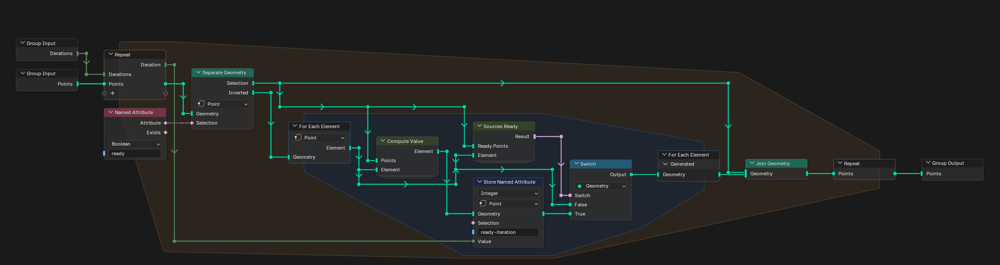

Sources Ready checks whether all the sources of a wire already have a value.

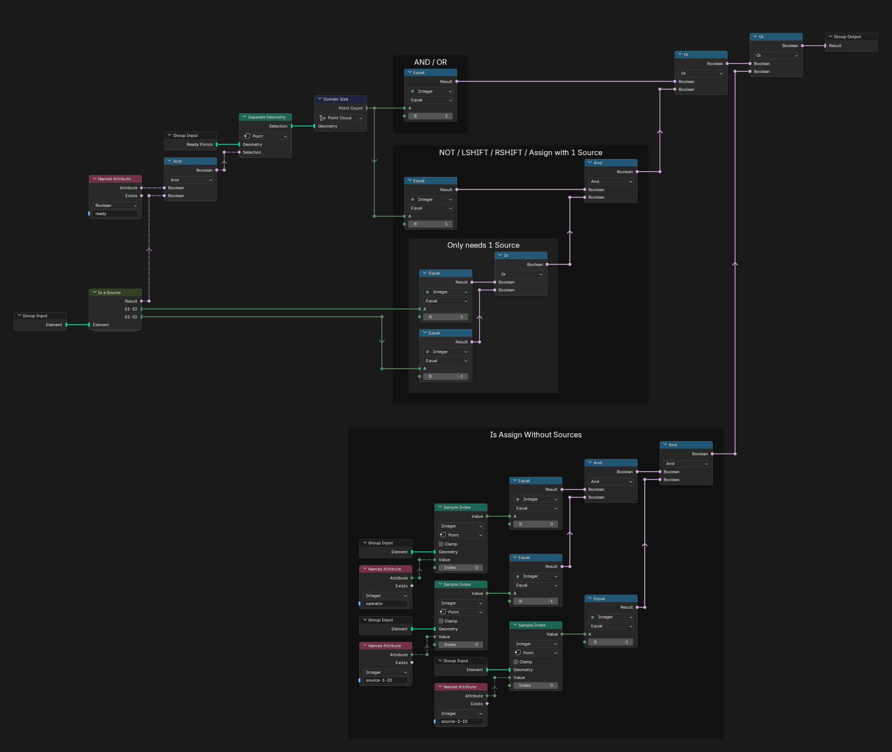

Is a Source tells whether a point is one of the sources of another.

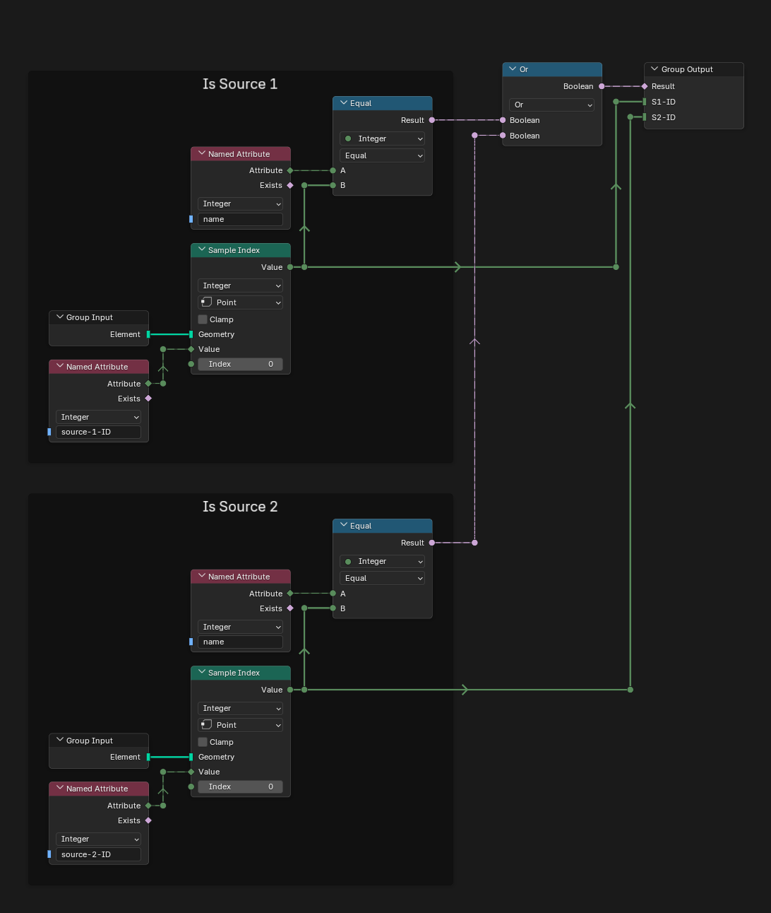

Compute Value applies the gate to the source values and keeps the result in 16 bits.

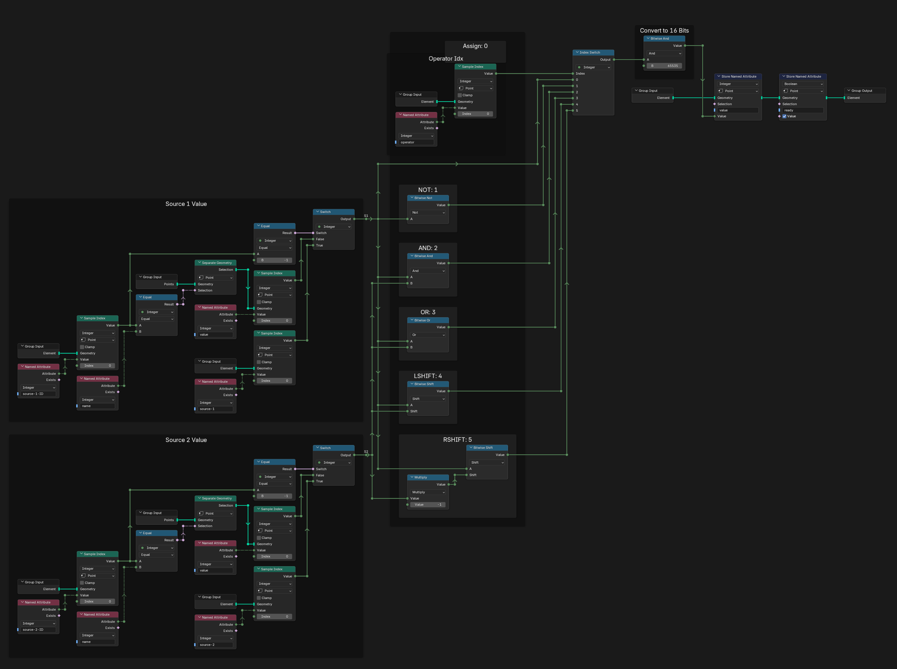

## Visualization

Init Position places each wire: one row per iteration, wires of the same iteration side by side, and the two long shift wires of each block on the sides.

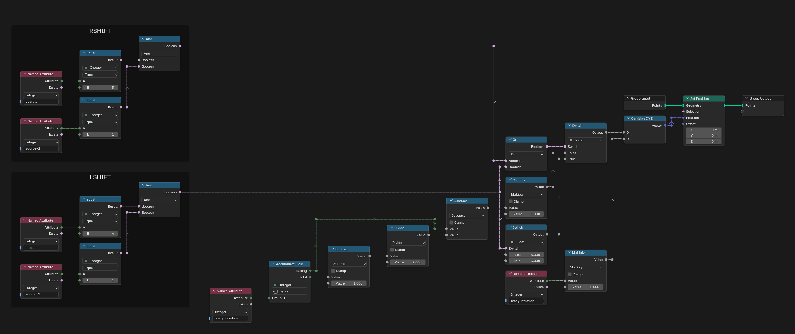

Create Circuit instances a gate on each point and draws the wires between them.

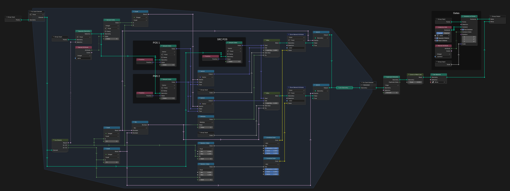

Wire draws one wire with right angles, from the output of a gate to the matching input of the next.

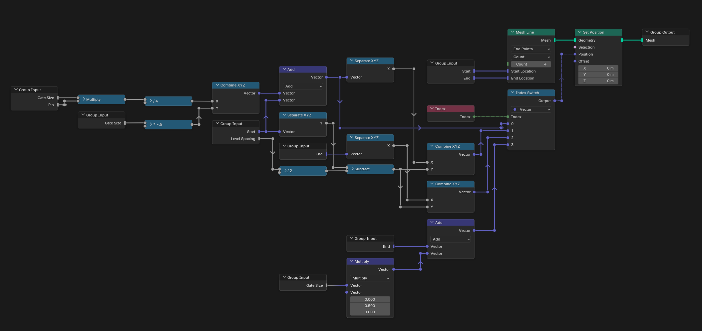

Curve to Mesh Line and Curve to Mesh Line - Gates turn the wires and the outlines of the gates into meshes for rendering.

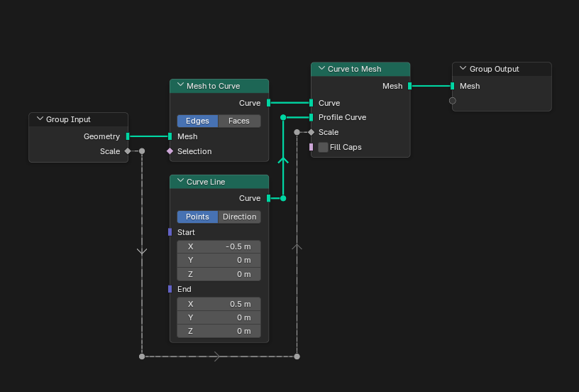

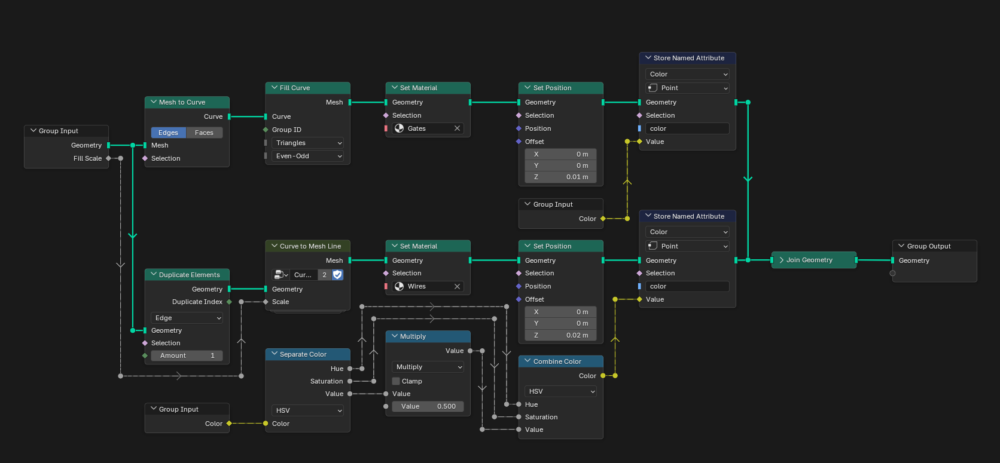

## Materials

### Gates

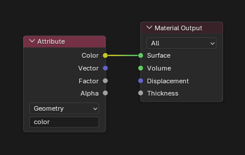

### Wires

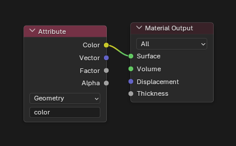

## Compositor

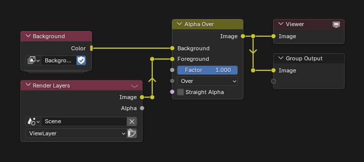
