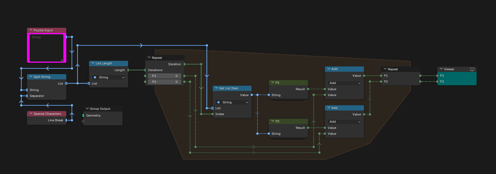
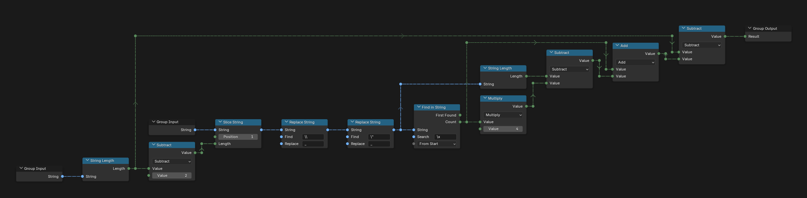
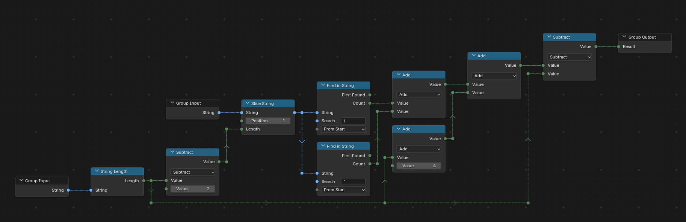

# Day 8: Matchsticks

https://adventofcode.com/2015/day/8

**Part 1:** each line of the input is a string literal with escape sequences (`\\`, `\"` and `\x` followed by two hex digits); find the total number of characters of code minus the number of characters the strings hold in memory.

**Part 2:** encode each line again as a new string literal, escaping its quotes and backslashes, and find the total number of characters of the encoded strings minus those of the original code.

There is no visualization for this day.

## Notes

- Paste the input into the "Puzzle Input" node.
- The answers are in the Viewer node: P1 and P2.

## Solution

### Day 8

The main tree splits the input into lines and sends each one to the P1 and P2 groups inside a repeat zone, which adds up their results.

### P1

P1 removes the outer quotes, replaces the escaped backslashes and quotes with a single character and counts the hex escapes, which take four characters of code for one in memory.

### P2

P2 counts the quotes and backslashes inside the outer quotes, which each need one more character, and adds four for the outer quotes: `"` becomes `"\"` at the start and `\""` at the end.

