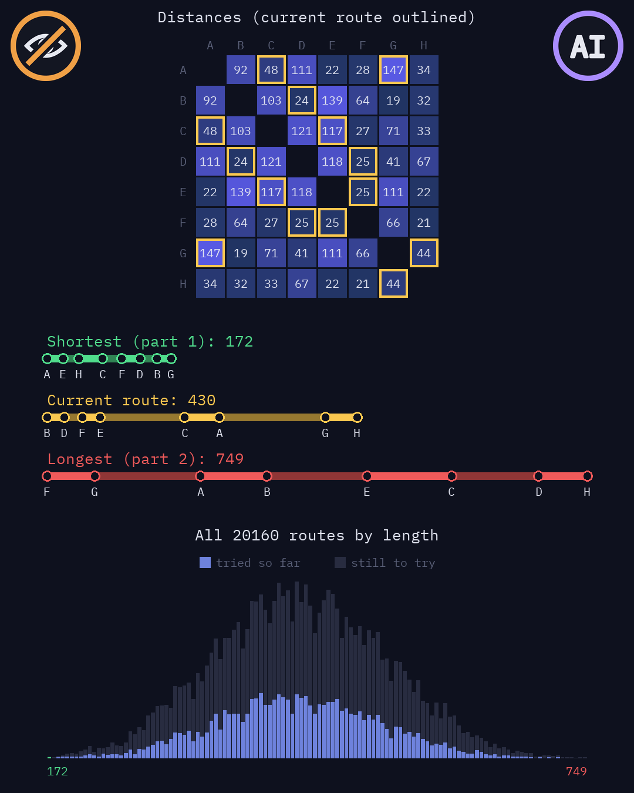
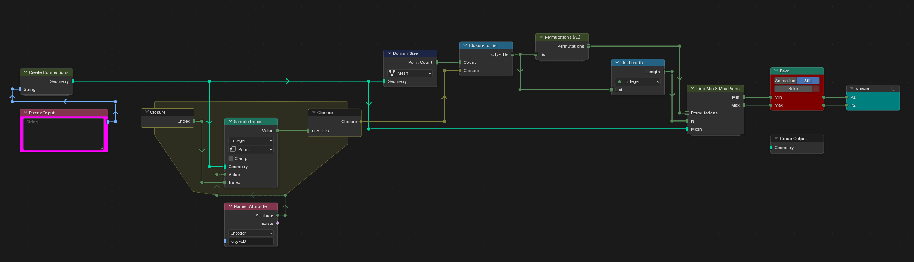
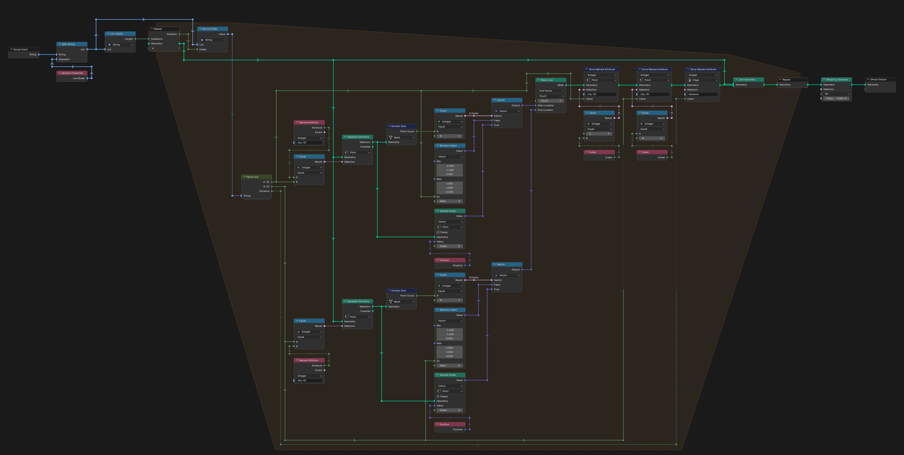
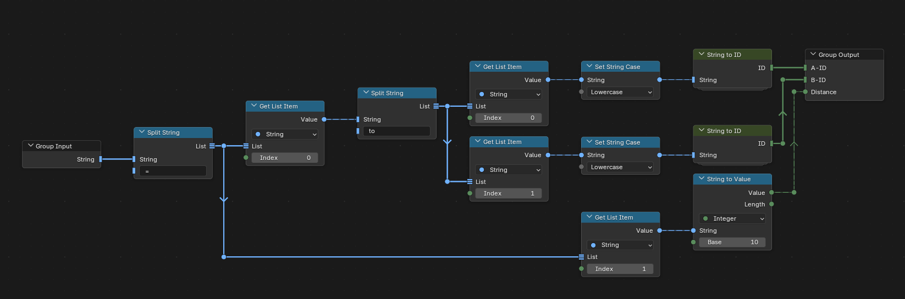
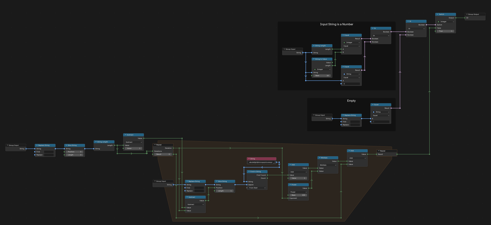
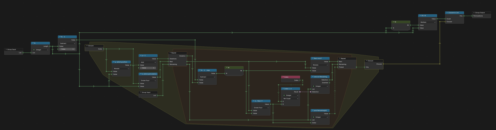
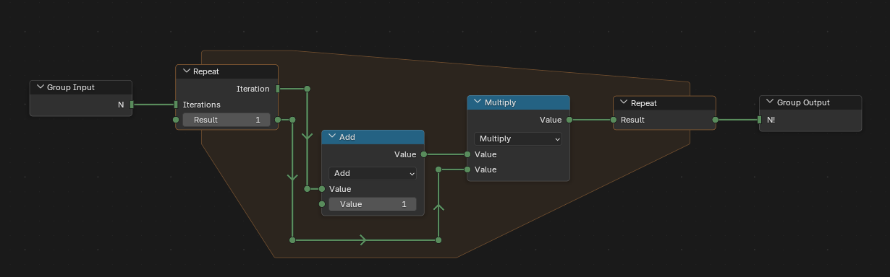
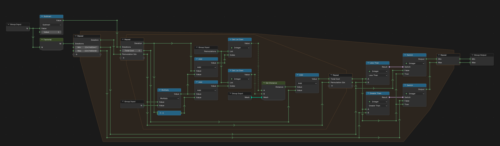
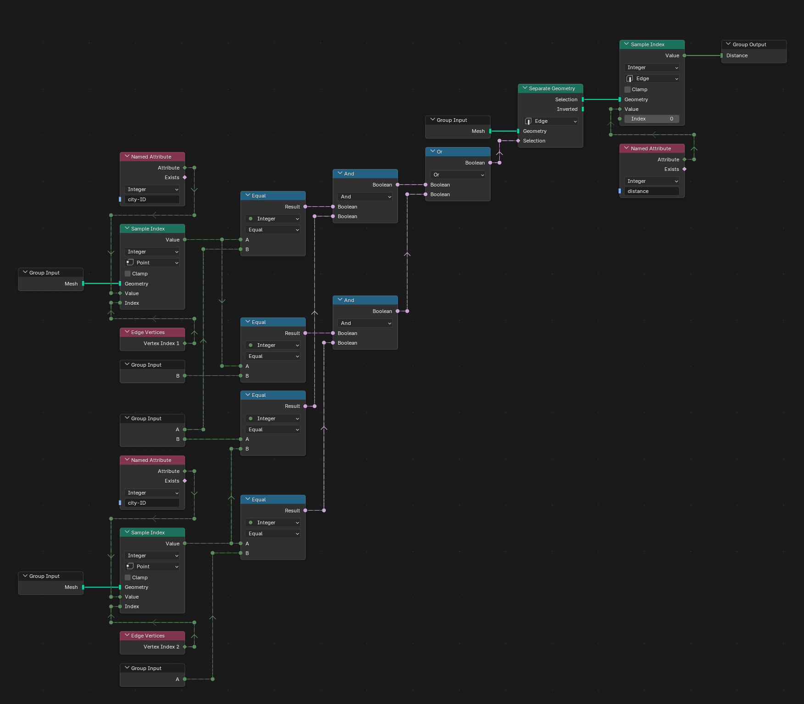

# Day 9: All in a Single Night

https://adventofcode.com/2015/day/9

**Part 1:** given the distance between each pair of locations, find the length of the shortest route that visits every location exactly once, starting and ending anywhere.

**Part 2:** find the length of the longest such route.

There is no visualization for this day. The input gives distances but no positions, and they do not fit on a real map, so any drawing of the routes on a map would be made up. The hard part was trying every route: Geometry Nodes has no recursion, so the list of all the orders of the locations is built by the Permutations (AI) group, which was made with AI. Everything else was made by hand.

   
  <em>Visualization idea, not built: made-up distances, drawn outside Blender</em>

## Notes

- Paste the input into the "Puzzle Input" node, then press Bake in the Bake node (Still). Trying every route takes a moment, and the bake keeps the result.
- The answers are in the Viewer: P1 is the shortest route and P2 the longest.

## Solution

The main tree builds the locations and their distances, lists the IDs of all locations, makes every order of that list and finds the shortest and longest total distance.

Create Connections reads the input line by line and builds a mesh: one point per location, with its ID in `city-ID`, and one edge per line, with its distance in `distance`. A location gets a random position the first time it appears; the positions only keep the points apart.

Parse Line splits a line into its two locations and the distance between them.

String to ID, from [day 7](../day07), turns a location name into a number, since Blender cannot store strings in named attributes.

Permutations (AI) makes every order of a list in one long list, the orders one after another. It was made with AI, not by hand. Each item computes its own value from its index: the index gives the order number and the position in it, and the order number, written in the factorial number system, picks each location from the ones not used yet.

Factorial multiplies 1 to N in a repeat zone.

Find Min & Max Paths walks through every order in a repeat zone, adds up the distances between consecutive locations in a nested repeat zone, and keeps the smallest and largest total.

Get Distance finds the edge between two locations, in either direction, and returns its distance.

## Visualization idea

An idea for an animation that shows only real data, drawn with Python and made-up distances (made with AI, not in Blender). It would go through every route, and the image is one moment of it:

- The distance table, one cell per pair of locations, with the legs of the route being tried outlined.
- The shortest route, the route being tried and the longest route, unrolled on a straight line, each leg as long as its real distance.
- How many routes have each total length: bright for the routes tried so far, dark for the rest. The shortest and longest routes are the two ends.
