# Day 10: Elves Look, Elves Say

https://adventofcode.com/2015/day/10

**Part 1:** starting from the input digits, apply the look-and-say rule 40 times (each run of equal digits becomes its length followed by the digit) and find the length of the result.

**Part 2:** the same with 50 steps.

My first version worked on strings, one character at a time, and part 1 took about five minutes. Since the length grows by about 30% each step, part 2 was out of reach. Storing each digit as a point turns a step into a few field operations on all the points at once, and 50 steps take less than a second.

  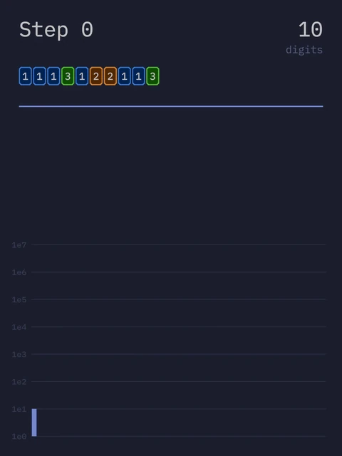

## Notes

- Paste the input into the "Puzzle Input" node, then press Bake in the Bake node before playing the animation.
- The animation shows one step at a time: the number of digits, the first and last 10 digits, one bar per step as wide as its length, and the length of every step on a logarithmic scale. Steps 40 and 50, the answers to parts 1 and 2, are marked in orange.
- The growth per step tends to Conway's constant, about 1.3036.

Fonts: IBM Plex Mono, SIL Open Font License 1.1 ([license](../../fonts/IBMPlexMono-LICENSE.txt)).

## Solution

The main tree turns the input into one point per digit, with the digit in `digit`. A repeat zone runs the steps. In each step, a point starts a run when its digit differs from the previous one, an Accumulate Field gives every point the number of its run and the length of that run (stored in `count` before anything else changes the points), one point per run is kept, and Duplicate Elements turns it into two: the length and the digit. The number of points is the length of the sequence.

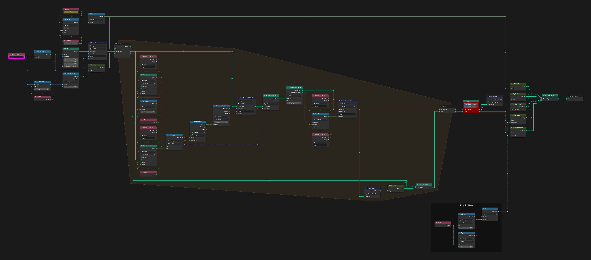

## Visualization

Adjust Bars and Adjust Bars Log place the bars of the two charts: one bar per step, with a linear or logarithmic height, and the answers in orange.

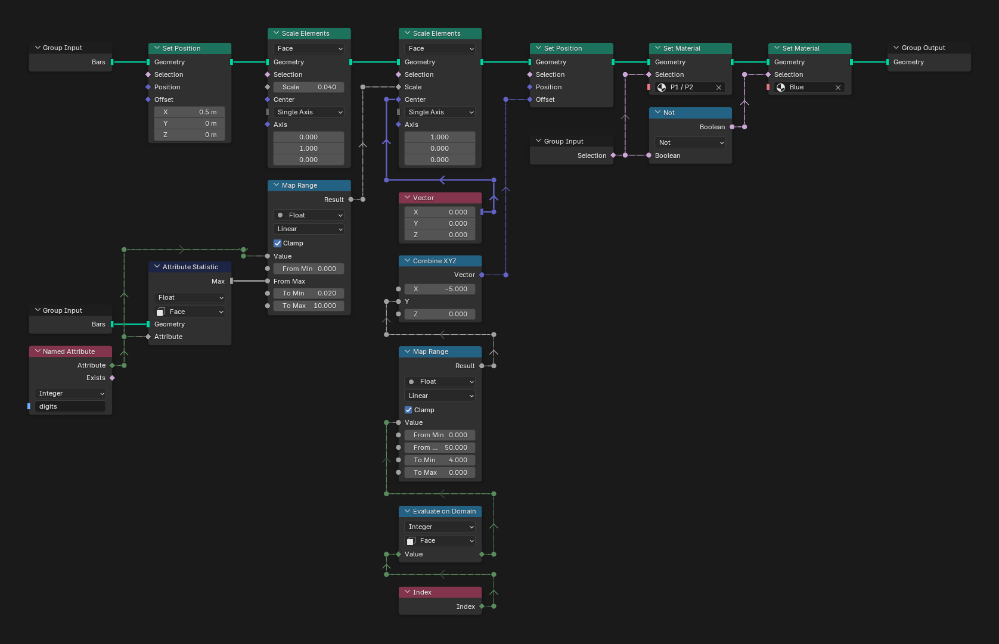

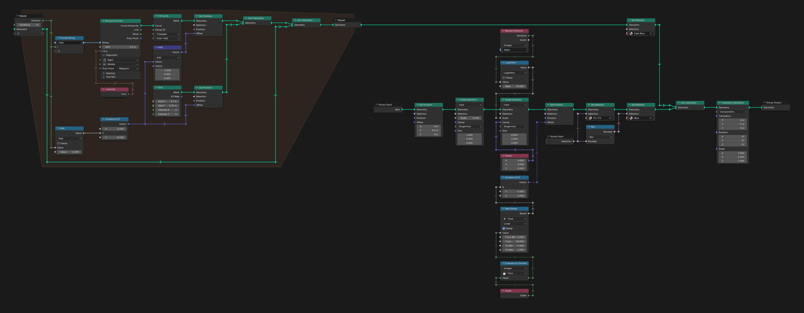

Digit Bar draws one bar.

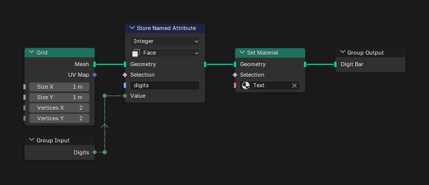

First and Last shows the first and last 10 digits of a step, with "..." between them once the sequence is longer than 20 digits.

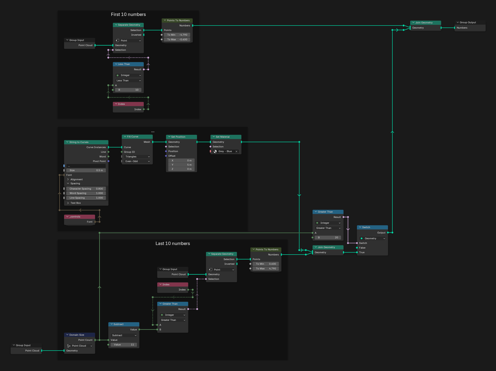

Points To Numbers turns points into digits colored by their value.

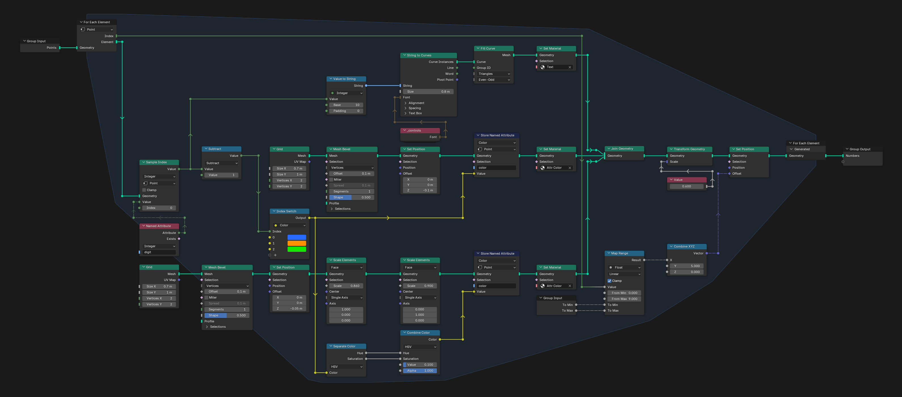

Step Text and Digits Text write the step number and the number of digits, and Format Number adds the thousands separators.

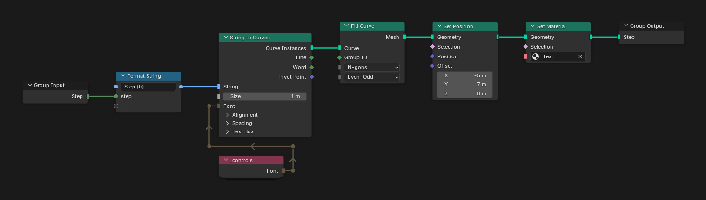

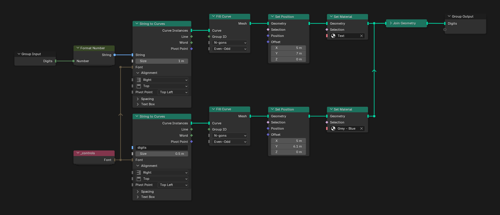

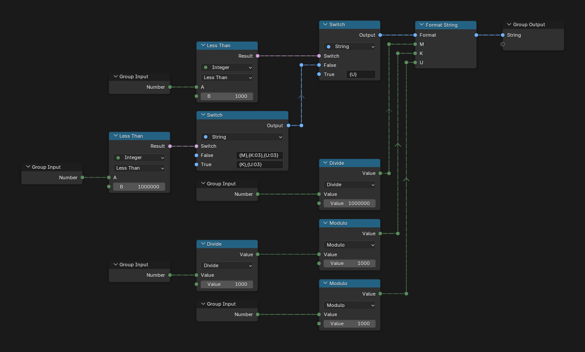

`_controls` holds the font shared by every text.

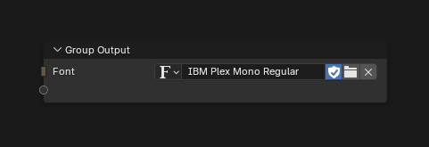

## Materials

### Attr Color

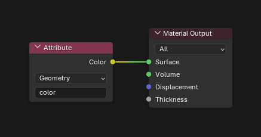

### Blue

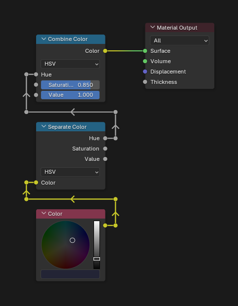

### Dark Blue

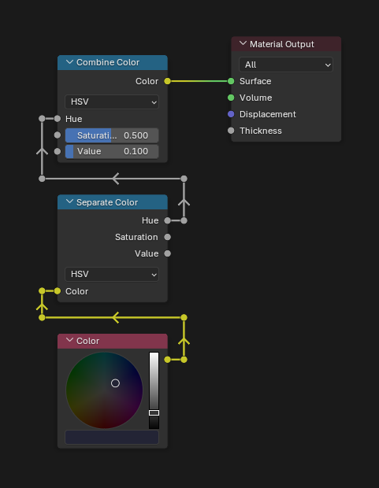

### Grey - Blue

### P1 / P2

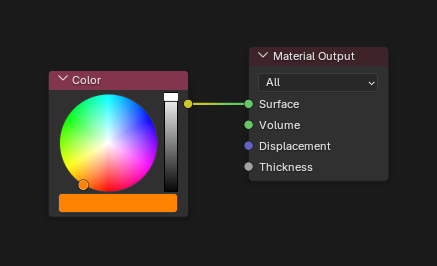

### Text

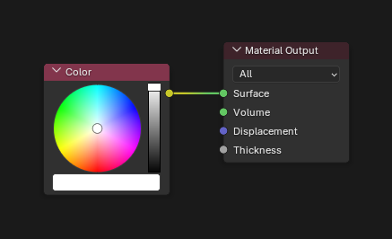

## Compositor

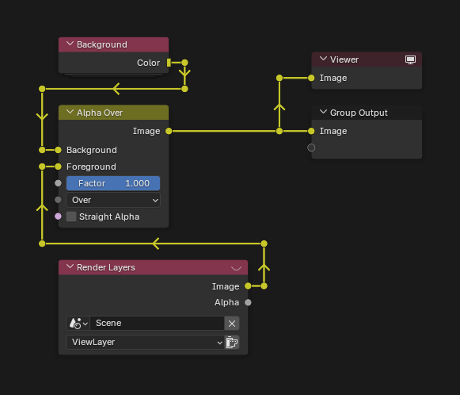
