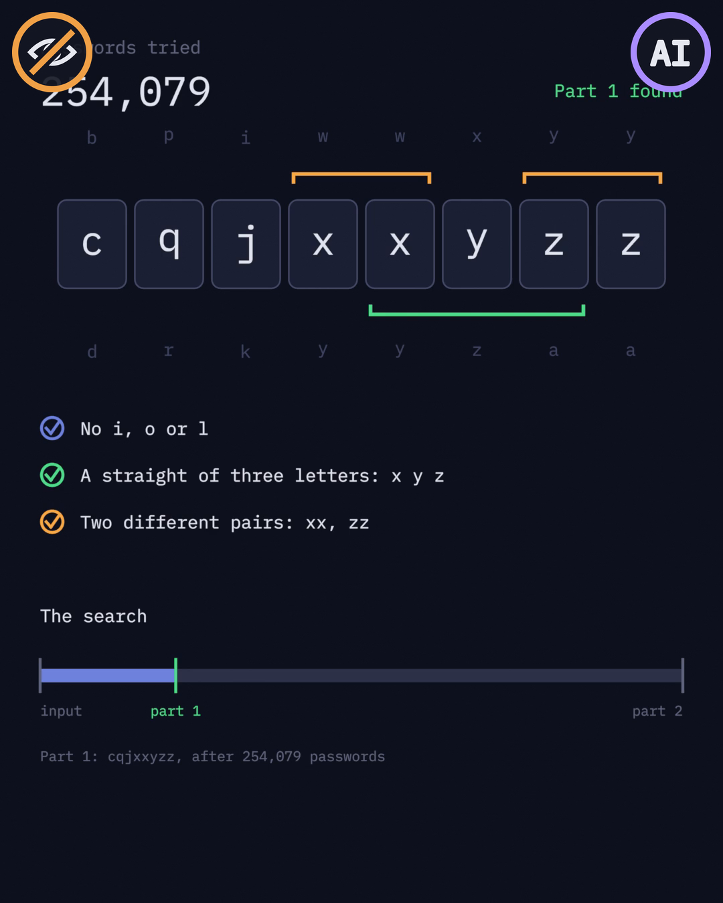
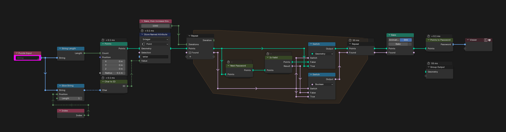
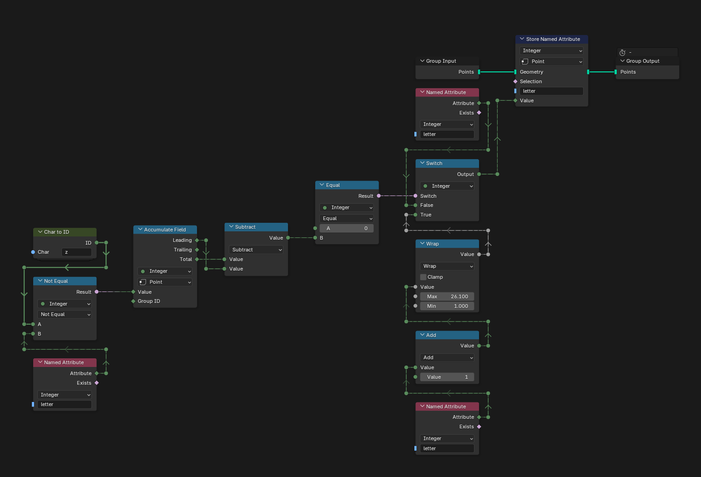
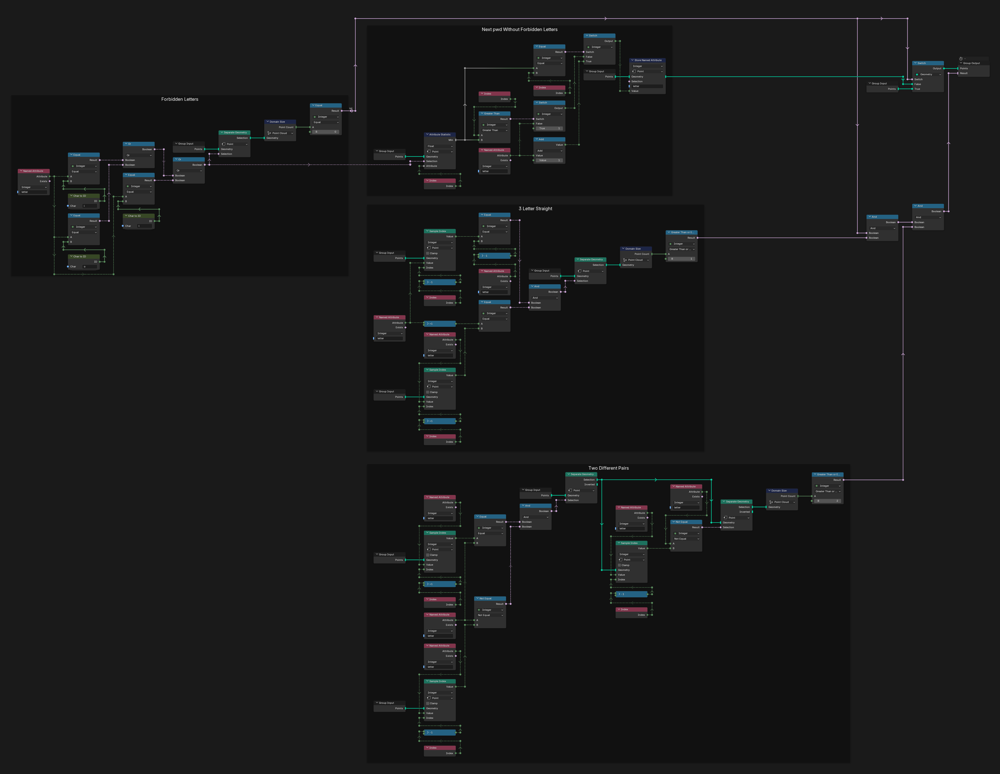
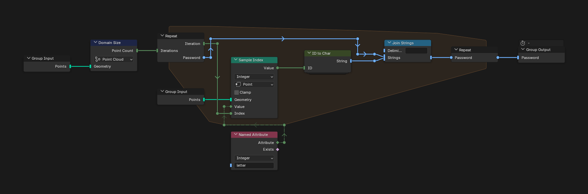
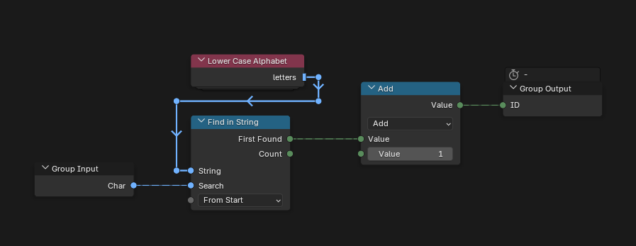
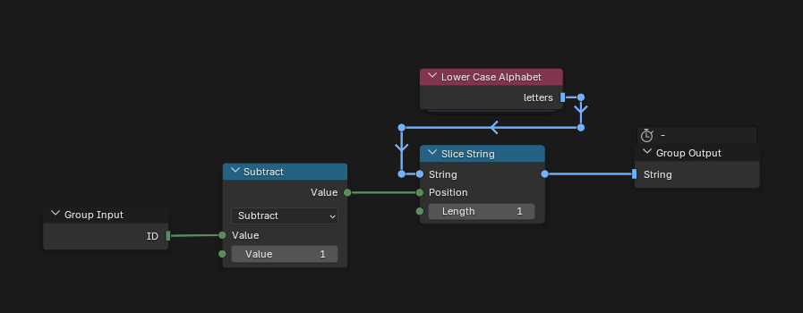
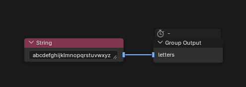

# Day 11: Corporate Policy

https://adventofcode.com/2015/day/11

**Part 1:** the input is a password of eight lowercase letters; increase it like a number in base 26 (a to z, carrying to the left) until it has an increasing straight of three letters, no i, o or l, and two different pairs of equal letters, and find that password.

**Part 2:** find the next valid password after that one.

There is no visualization for this day. Each letter is a point, and a repeat zone moves to the next password and checks the rules until one passes. Next Password finds the letters to increase with an Accumulate Field: the last letter, and every letter followed only by z's. A password with an i, o or l jumps straight past every password that still has that letter.

The image below, also the thumbnail, is a frame of a test visualization made with AI in a separate Blender file, which is not part of this repository. That is all the AI badge means; the node trees are made by hand.

   
  <em>Visualization idea, not built: a frame of a test visualization made with AI</em>

## Notes

- Paste the input into the "Puzzle Input" node. The number of iterations starts at 1000 so the file opens quickly: press Bake in the Bake node (Still) first, so the tree stops recomputing on every change, then raise it (about a million for my input) and bake again. The repeat zone keeps the first valid password, so it takes a while.
- The answer is in the Viewer. For part 2, paste the part 1 answer as the input and bake again.

## Solution

### Day 11

The main tree turns the input into one point per letter, with its position in the alphabet in `letter`, and runs the repeat zone: Next Password, then Is Valid, until a password is valid. Points to Password turns the points back into text.

### Next Password

Adds one to the last letter and to every letter followed only by z's, wrapping z around to a.

### Is Valid

Checks the three rules, one frame each, and also returns the next password without forbidden letters: the first i, o or l becomes the next letter and everything after it becomes a.

### Points to Password

Joins the letters of the points into a string.

### Char to ID

Turns a letter into its position in the alphabet.

### ID to Char

Turns a position in the alphabet back into its letter.

### Lower Case Alphabet

The alphabet that Char to ID and ID to Char use.

## Visualization idea

A test visualization made with AI in a separate Blender file, not part of this repository. The image is the moment part 1 is found:

- How many passwords have been tried, and the current one, one tile per letter, with the letter before and after each one.
- The two pairs of equal letters marked above, and the straight of three letters below.
- The three rules, ticked as they pass.
- The search: a bar from the input to the part 1 and part 2 passwords.

   
  <em>A frame of a test visualization made with AI</em>

