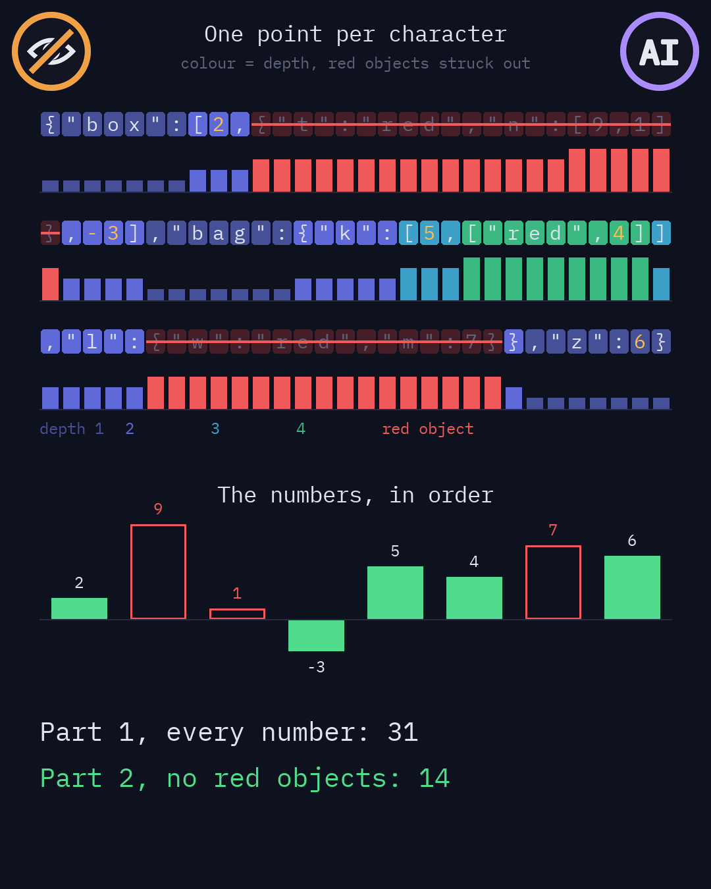
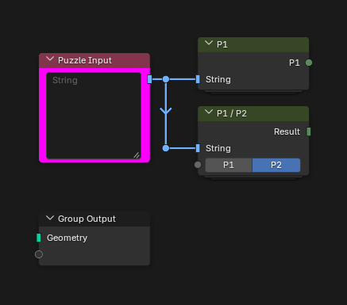
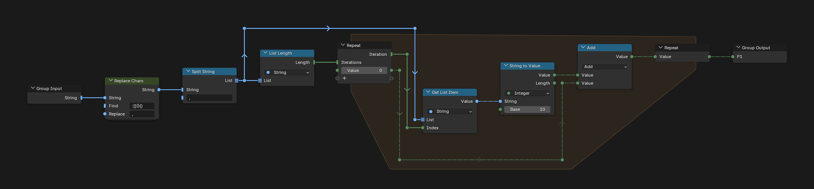
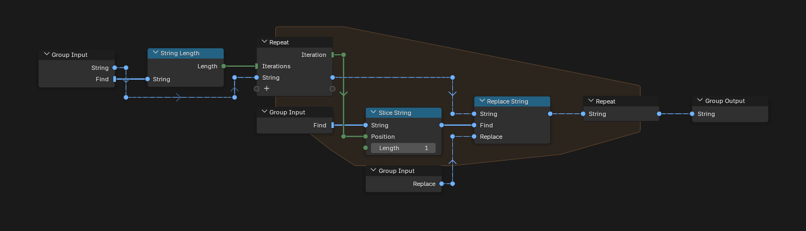

# Day 12: JSAbacusFramework.io

https://adventofcode.com/2015/day/12

**Part 1:** the input is a JSON document; find the sum of all the numbers in it.

**Part 2:** ignore every object that has the value "red" in one of its properties, with everything inside it, and find the sum of the numbers left.

There is no visualization for this day. JSON is usually read with recursion, which Geometry Nodes does not have, so P1 / P2 makes one point per character and finds everything with Accumulate Field instead: the depth of each character, the brackets it is in, the red objects and the numbers.

   
  <em>Visualization idea, not built: a made-up JSON, drawn outside Blender</em>

## Notes

- Paste the input into the "Puzzle Input" node.
- P1 is a first, simpler solution of part 1. P1 / P2 solves both parts: choose the part in its menu.
- The answers are on the outputs of the P1 and P1 / P2 nodes: hover over them to see the value.

## Solution

### Day 12

The main tree sends the input to P1 and to P1 / P2.

### P1

P1 turns every bracket and colon into a comma, splits the text at the commas and adds up the value of each piece in a repeat zone. Pieces that are not numbers count as 0.

### Replace Chars

Replace Chars replaces each character of Find with Replace, one character per iteration of a repeat zone.

### P1 / P2

P1 / P2 makes one point per character and stores one attribute per frame, from left to right:

- `char`: the character of each point.
- `digit`, `minus`, `open`, `close`, `obj_open`, `obj_close`: what the character is. `digit` is -1 for anything but a digit.
- `red`: the text from this character on starts with `:"red"`, a property with the value "red".
- `depth`: how many brackets are open around the character, an Accumulate Field of `open` minus `close`.
- `nth`: how many brackets were opened before at the same depth. With `depth` it gives `bracket`, the ID of the innermost brackets around the character.
- `red_object`: the innermost brackets hold a `red`, the Total of an Accumulate Field grouped by `bracket`.
- `mark`: +1 at the opening brace of a red object and -1 at its closing brace. `skip`, their running sum, is above 0 inside a red object, at any depth.
- `part`: the character is part of a number, a digit or a minus sign. `number_start` marks the first one, and `number`, their running sum, gives each number its own ID.
- `place`, `negative`, `value`: the place of each digit in its number, the sign of the number, and the digit times its power of ten, with the sign.

The result is the sum of `value` over all points for part 1, and over the points without `skip` for part 2.

## Visualization idea

An idea for an animation that shows only real data, drawn with Python and a made-up JSON (made with AI, not in Blender). It would build up the points of P1 / P2 one step at a time, and the image is its last moment:

- One cell per character, coloured by its depth, with the red objects struck out.
- Under each character, a bar as tall as its depth: the red objects are the red stretches.
- The numbers in order, as bars: part 1 adds them all, part 2 only the ones outside red objects.

   
  <em>A made-up JSON, drawn outside Blender</em>

