# Day 13: Knights of the Dinner Table

https://adventofcode.com/2015/day/13

**Part 1:** the input says how much each guest's happiness changes when sitting next to each other guest; seat everyone at a round table so that the total change is as high as possible, and find that total.

**Part 2:** add yourself to the table, with no change in happiness for you or for your neighbours, and find the new best total.

There is no visualization for this day, only an idea for one below. Each seating plan is a circle with one point per guest, so the table really is round. For part 2 no new plans are needed: you sit best at the weakest connection of a plan, so its total is the plan's total minus that connection.

  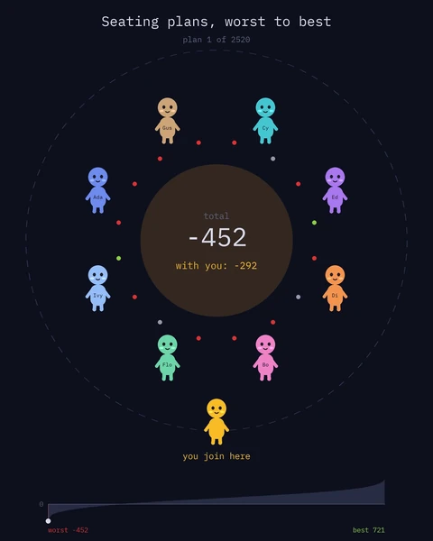 
  <em>Visualization idea, not built: made-up guests, animated outside Blender</em>

## Notes

- Paste the input into the "Puzzle Input" node, choose the part in the Part menu of the modifier, then press Bake in the Bake node (Still). Trying every plan takes a moment, and the bake keeps the result.
- The answer is in the Viewer: Happiness. A second Viewer shows every plan, sorted by happiness for a future visualization.

## Solution

### Day 13

The main tree reads the guests, makes every seating plan, finds the happiest ones, sorts all plans by happiness with Sort Elements and bakes the result. The output is one of the best plans.

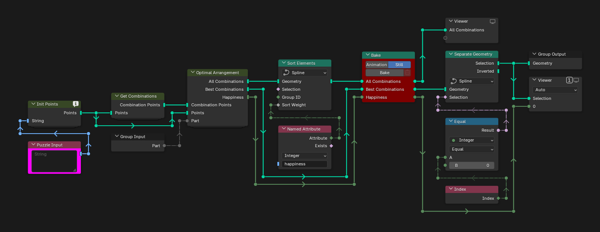

### Init Points

Init Points makes one point per guest, with its ID in `person`, and stores on each guest one attribute per other guest, named after that guest's ID, with the happiness change of sitting next to them.

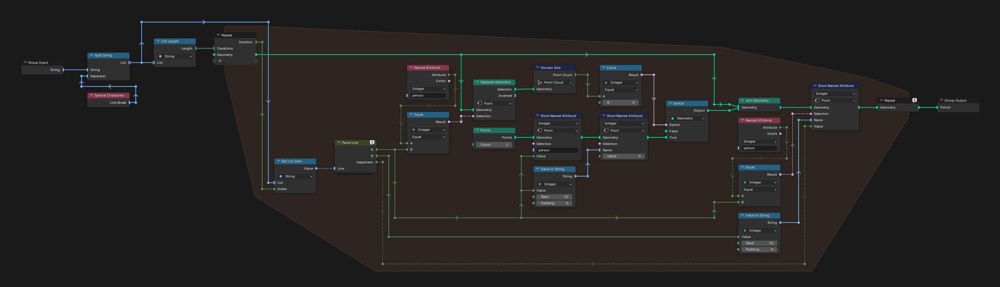

### Parse Line

Parse Line splits a line into the two guests, as names and IDs, and the happiness change, negative when the guest would lose happiness.

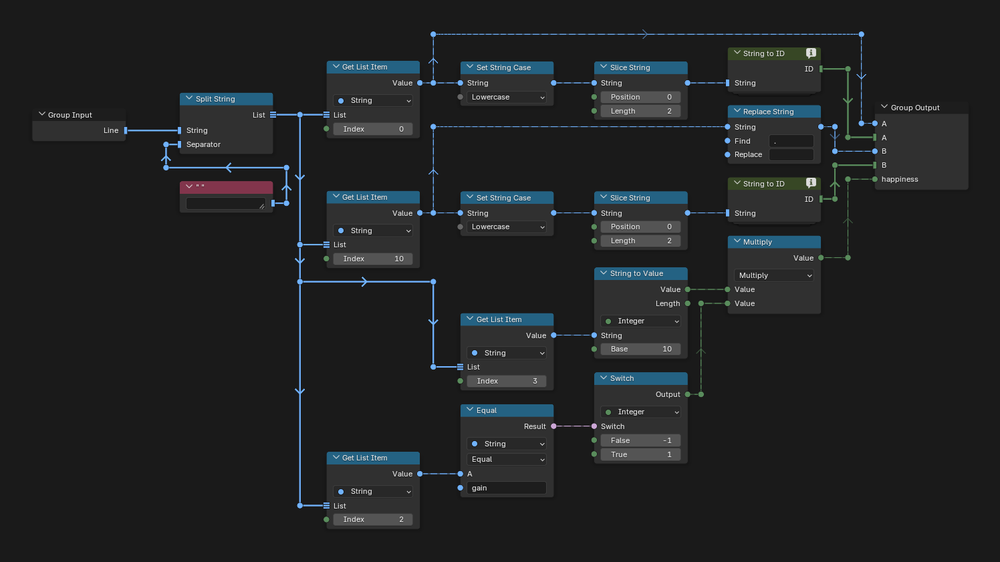

### String to ID

String to ID, from [day 7](../day07), turns a name into a number, since Blender cannot store strings in named attributes.

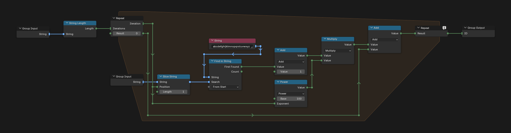

### Get Combinations

Get Combinations lists the IDs of the guests, makes every order of that list and turns each order into a circle with one point per guest, its ID in `person`.

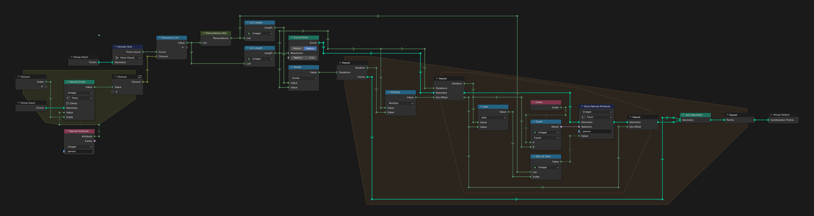

### Permutations (AI)

Permutations (AI), from [day 9](../day09), makes every order of a list in one long list. It was made with AI, not by hand.

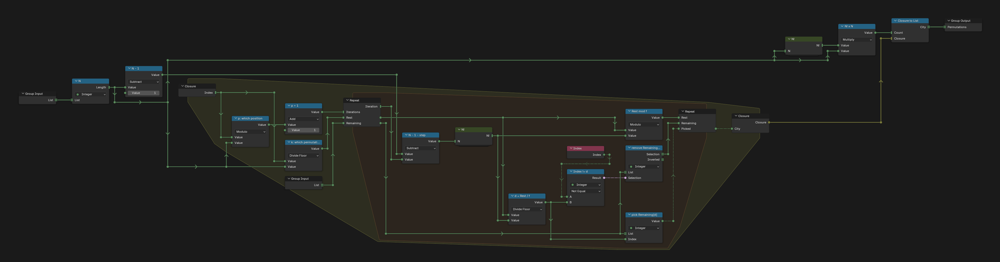

### Factorial

Factorial multiplies 1 to N in a repeat zone.

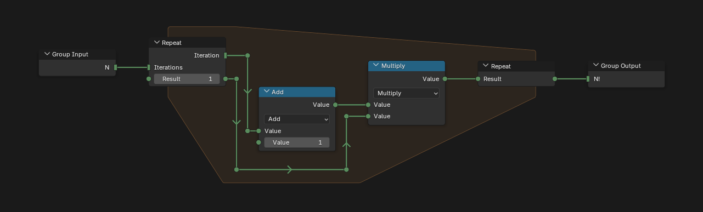

### Optimal Arrangement

Optimal Arrangement computes the happiness of every plan in a For Each zone and keeps the plans with the highest one.

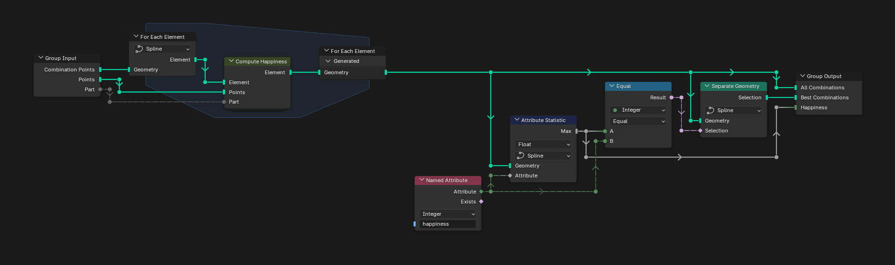

### Compute Happiness

Compute Happiness turns a plan into a closed loop of edges, one per pair of neighbours, and adds up what both neighbours feel about each other. For part 2 it subtracts the smallest pair, where you sit.

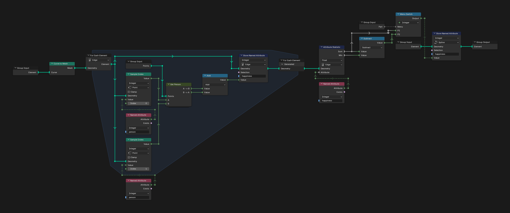

### Get Person

Get Person returns what guest A feels about guest B and what B feels about A.

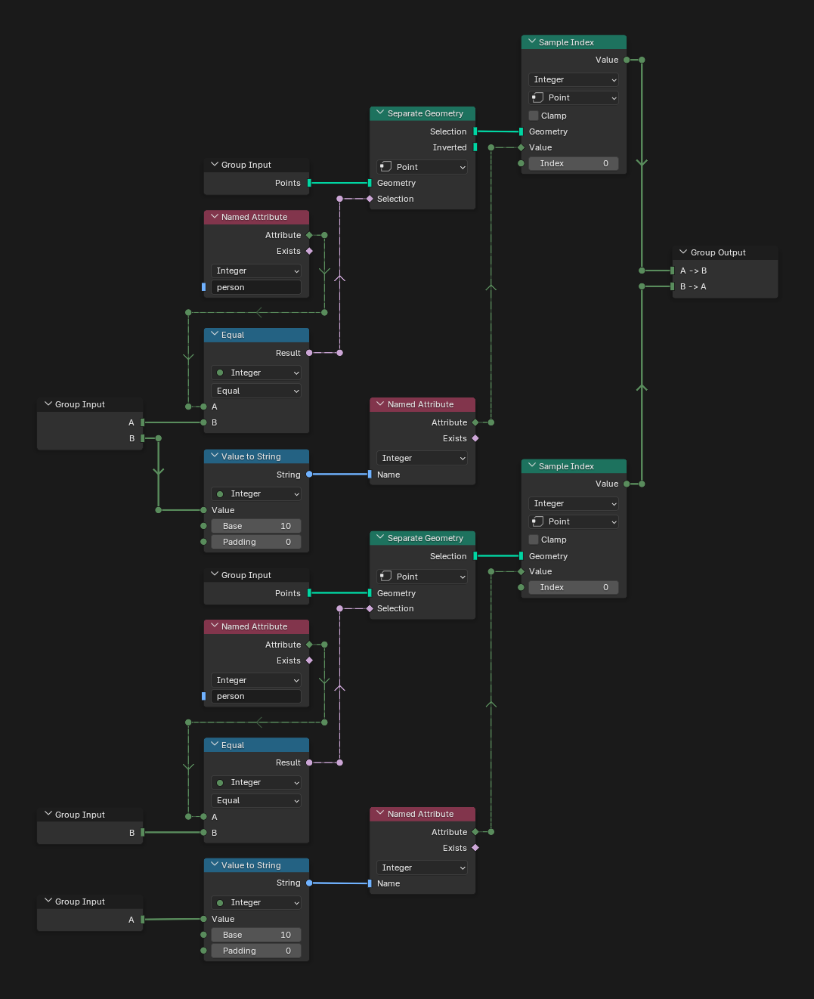

## Visualization idea

An idea for an animation that shows only real data, made with Python and made-up guests (made with AI, not in Blender). The main tree already sorts the plans by happiness, so the animation goes through them from worst to best: here 10 plans, evenly spaced from the worst to the best.

- The round table, with the total of the plan in the centre.
- Between plans, the guests who change seats walk to their new place, moved by a simulation zone in Blender. Turning or mirroring the next plan does not change it, so it is turned to keep the walks short.
- Once seated, each guest shows a reaction towards each neighbour: happy, neutral or angry.
- Part 2 at the same time: you stand on a second circle behind the table, always at the bottom, where the weakest connection is turned to. The centre also shows the total with you. When that connection is negative, you raise the total.
- At the bottom, every plan by happiness, bright for the plans shown so far. Totals can be negative: they are red below the zero line.

   
  <em>10 plans, from the worst to the best</em>

  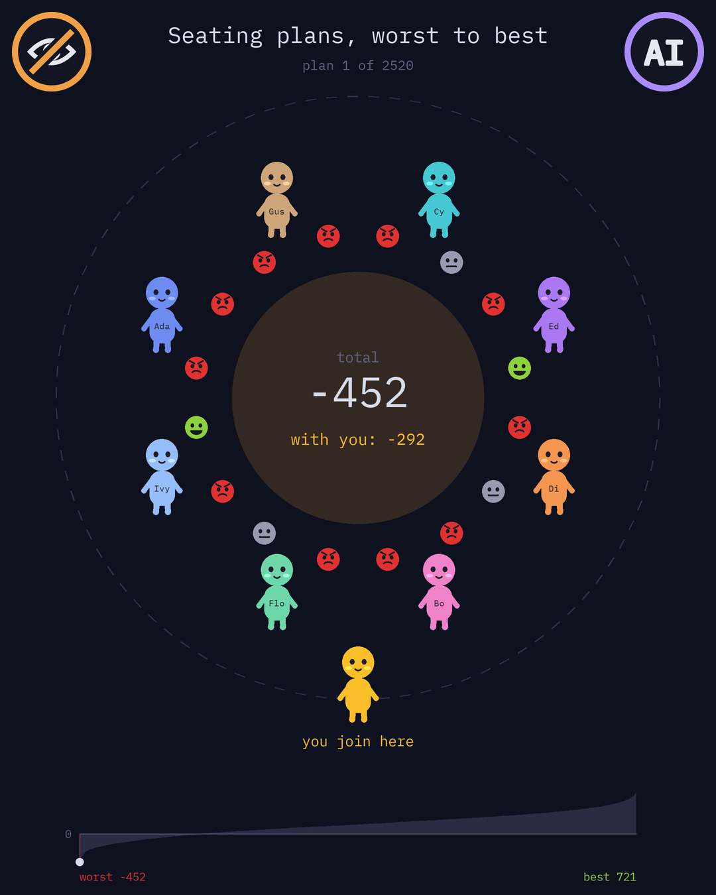 
  <em>The worst plan: almost everyone is angry</em>

  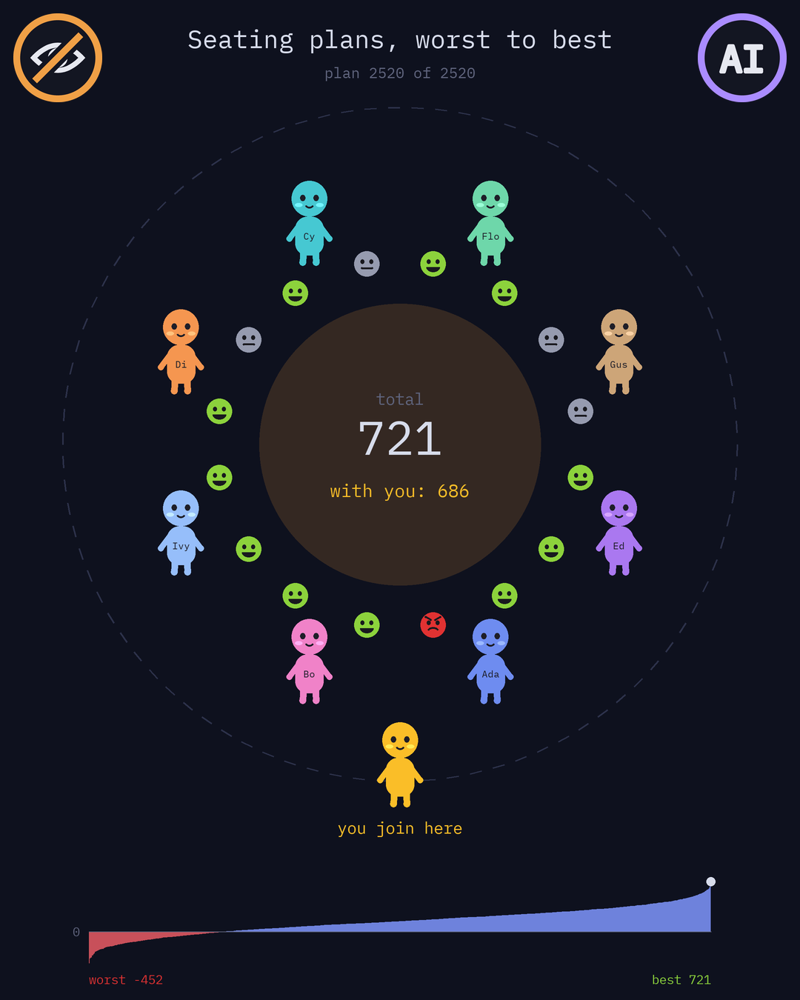 
  <em>The best plan</em>

