# Day 14: Reindeer Olympics

https://adventofcode.com/2015/day/14

**Part 1:** each reindeer flies at its own speed for a number of seconds, then has to rest for a number of seconds, over and over; find how far the reindeer that went furthest has flown after 2503 seconds.

**Part 2:** every second, each reindeer in the lead at that moment gets one point; find the most points after 2503 seconds.

This day was built for the visualization from the start, and the discovery was the simulation zone. The first version computed the whole race again on every frame. A simulation zone takes the reindeer once, at the start, and each step only moves the race on by the second of the current frame, if it has not been computed yet. Baking the animation with the simulation is quick. I also liked making the stamina indicator around each head, like the stamina wheel of Zelda: Breath of the Wild. There are many ways to make one, and this is only one of them.

  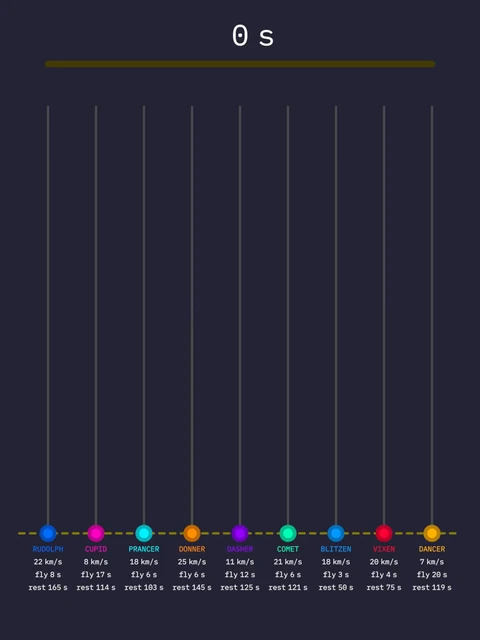

## Notes

- Paste the input into the "Puzzle Input" node and press Bake in the Bake node (a simulation only moves forward one frame at a time, so playing from the start also works).
- The tracks are scaled by the part 1 answer, so the first bake only gives the answers: go to the last frame and look at the "Max Distance (P1)" and "Max Score (P2)" outputs of the Bake node with a Viewer.
- Write the part 1 answer in the "P1 Answer" output of the `_controls` group and bake again: now the winner of part 1 reaches the top of its track, and the animation is ready.
- The race starts at frame 10 and moves one second per frame, so it ends at frame 2512. The scene runs at 240 fps, so its 2640 frames last 11 seconds.
- Each track fills up as its reindeer flies. The ring around a head shows how much of the current flight (bright) or rest (dark) is left. A dashed line marks the leader, and at the end the P1 and P2 badges mark the winners of each part.
- The colour management uses the Standard view transform instead of the default, for brighter colours.

Fonts: IBM Plex Mono, SIL Open Font License 1.1 ([license](../../fonts/IBMPlexMono-LICENSE.txt)).

## Solution

### Day 14

The main tree reads the reindeer, runs the race in Compute Race and draws it. Its frames: Tracks (the background track of each reindeer), Reindeer Color Tracks (the part already flown), Reindeer Heads (the heads and their stamina rings), Reindeer Info (name, speed, flight and rest under each track) and Leader Position (P1) and (P2) (where the leader of each part is). The tracks are tubes made with Curve to Tube, from Blender's Essentials assets.

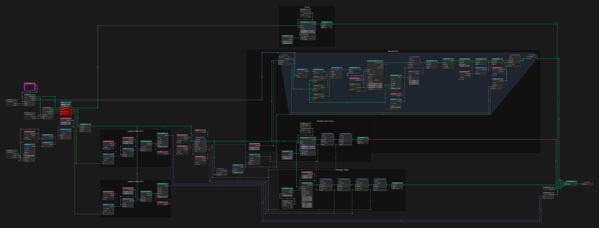

### _controls

`_controls` holds the values shared by the other trees: the size of the drawing, the start frame and length of the race, the part 1 answer, the sizes of the tracks, heads and text, and the font.

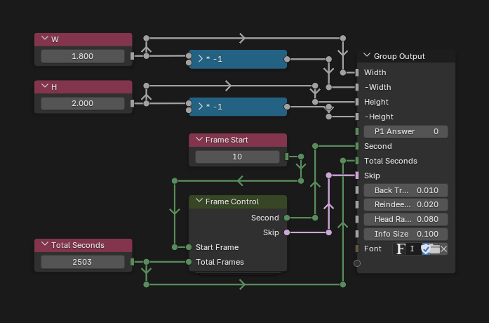

### Frame Control

Frame Control turns the frame into the second of the race being computed, and tells the simulation to skip the frames before the start and after the end.

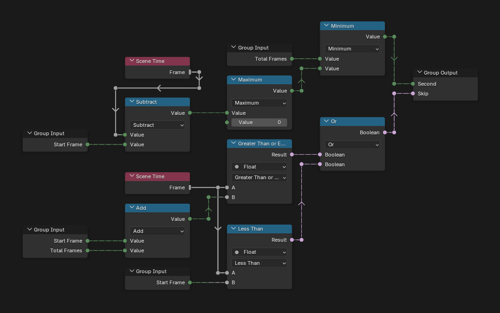

### Init Points

Init Points reads each line of the input into a spline, one per reindeer, side by side, with its `speed`, `duration` (of a flight) and `rest` in attributes. It also makes the background tracks and the list of names.

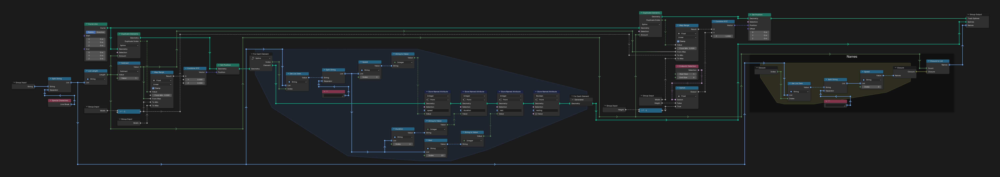

### Compute Race

Compute Race moves the race on by one second in a simulation zone. A reindeer flies while the second, modulo its flight plus its rest, is below its flight time; then its spline grows by its speed and `total_distance` adds it. `fly-factor` and `rest-factor` store how far into the current flight or rest it is, for the stamina ring. For part 2, every reindeer whose distance equals the largest one gets a point in `score`.

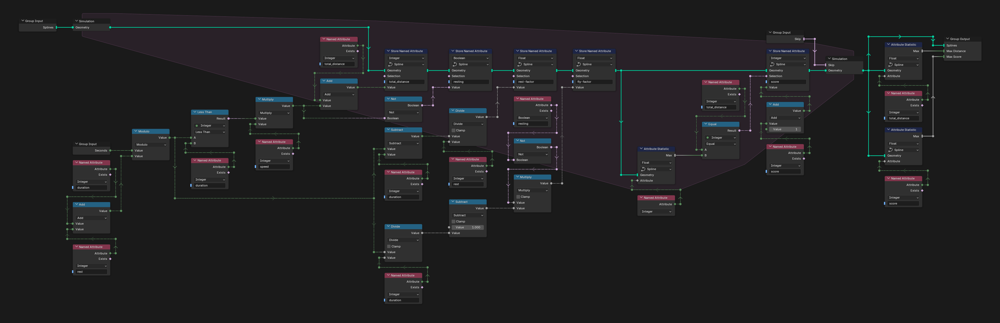

### Get Attr

Get Attr reads an attribute of the first point of a geometry, by name.

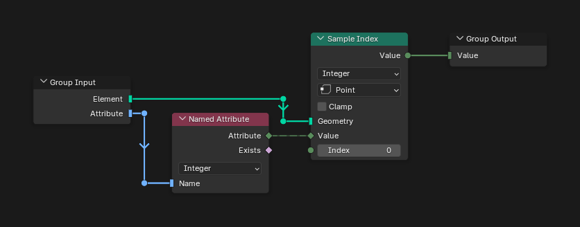

## Visualization

### Seconds Viz

Seconds Viz draws the clock at the top: the second of the race and a bar that fills up to 2503.

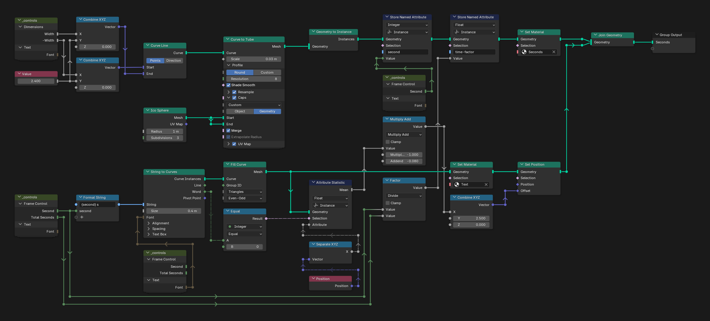

### Winners Info

Winners Info draws the dashed line at the leader's height and the P1 and P2 badges over the leaders.

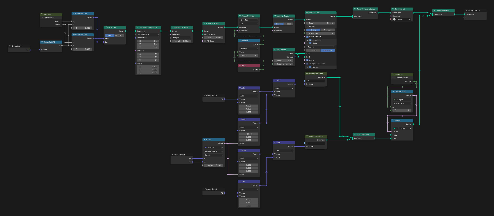

### Winner Indicator

Winner Indicator is one badge: a circle with its text.

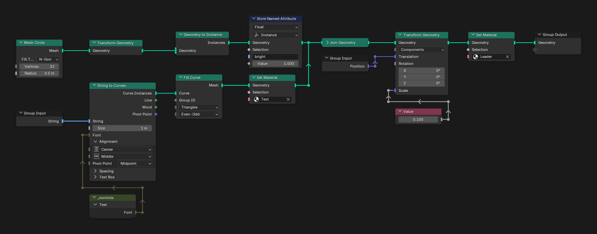

## Materials

### Leader

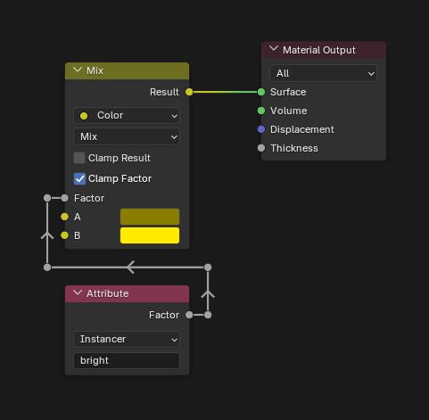

### Reindeer

### Reindeer Bright

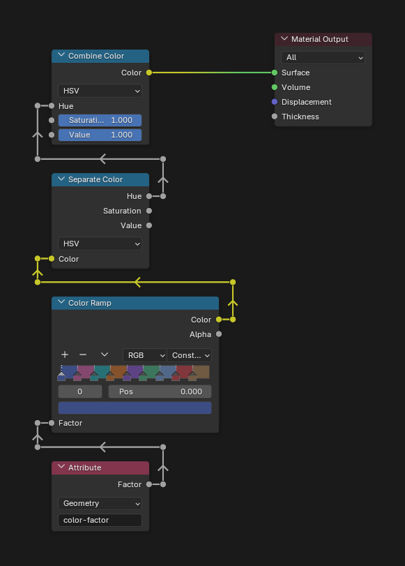

### Reindeer Head

The head of each reindeer in its colour, with the stamina ring: a radial gradient compared with `fly-factor` or `rest-factor`.

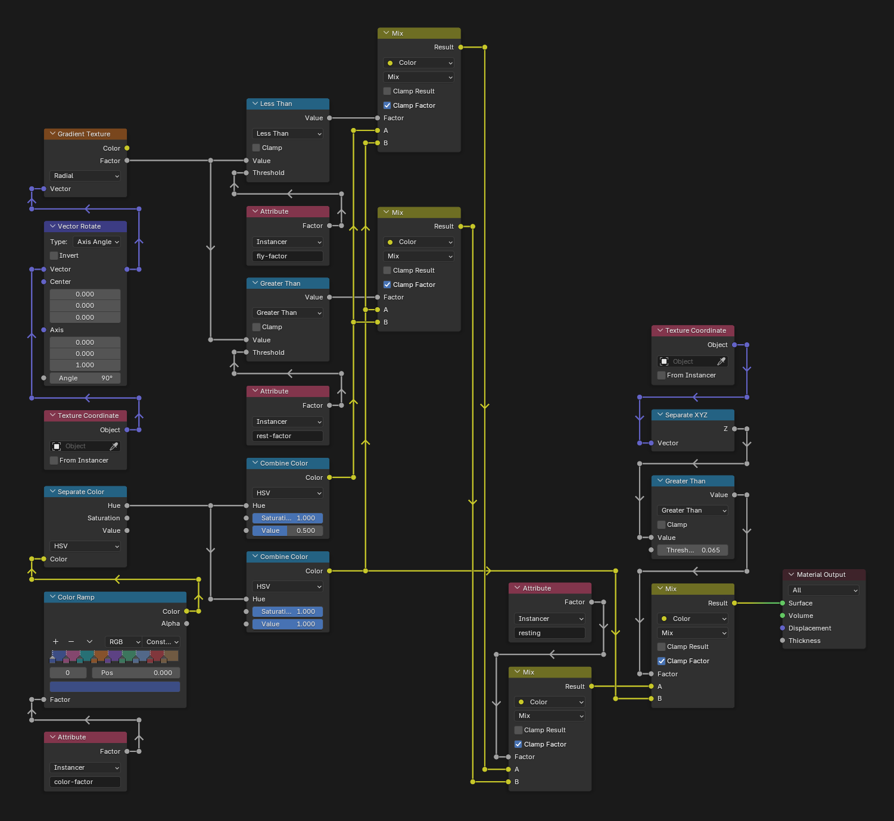

### Seconds

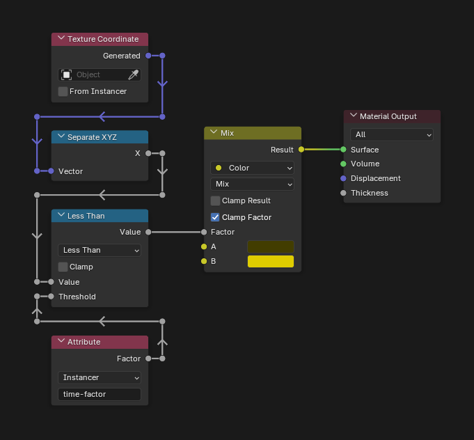

### Text

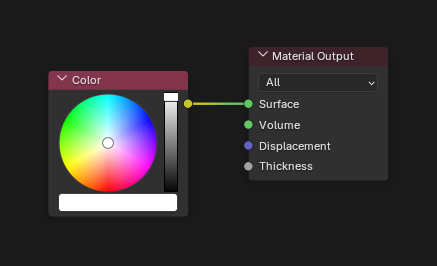

### Track

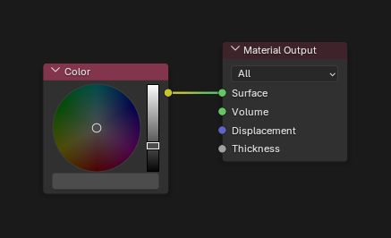

## Compositor

### Compositor Nodes

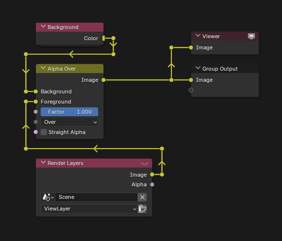

### Background

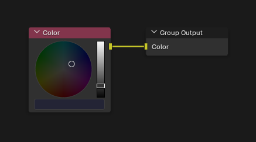
