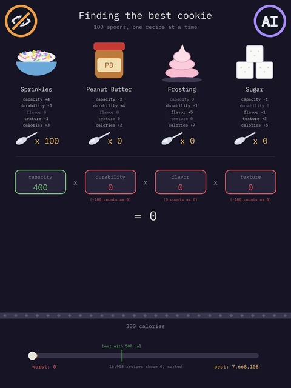
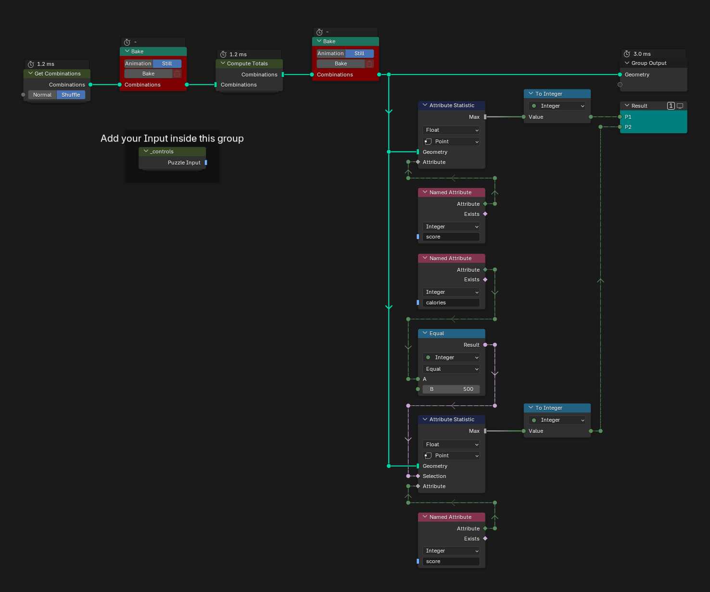
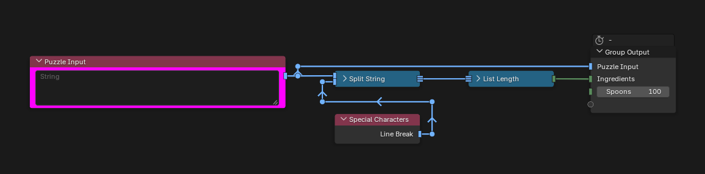
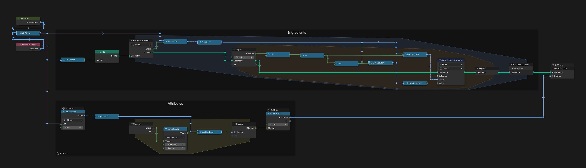
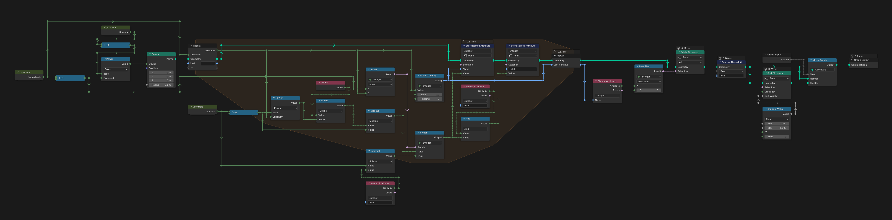
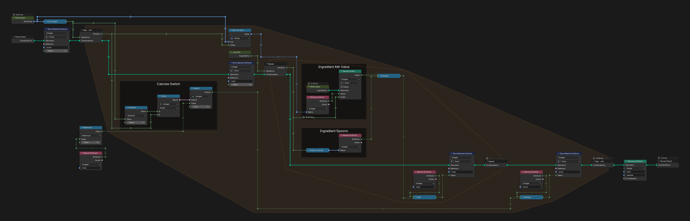
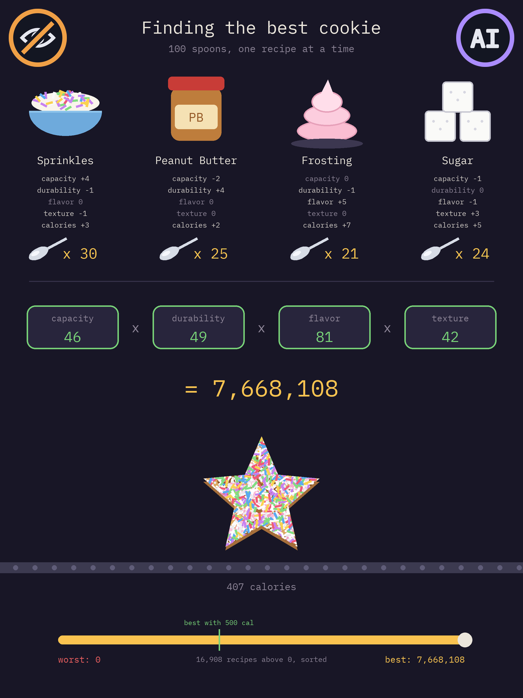

# Day 15: Science for Hungry People

https://adventofcode.com/2015/day/15

**Part 1:** each ingredient adds some capacity, durability, flavor, texture and calories per teaspoon; split exactly 100 teaspoons among the ingredients so that the product of the capacity, durability, flavor and texture totals (a negative total counts as 0, calories do not count) is as high as possible, and find that score.

**Part 2:** the same, but only with recipes of exactly 500 calories.

There is no visualization for this day, only an idea for one below. Every recipe is a point: its index, written in base 101, gives the teaspoons of each ingredient, and the points that go over 100 are deleted, which leaves all 176,851 recipes. My first version computed each recipe in a For Each zone, with a loop over the ingredients and properties inside, and it never finished. The ingredient values are the same for every recipe, so the loops now go over that table, 16 steps in all, and each step works on all the recipes at once, which is almost instant.

   
  <em>Visualization idea, not built: made-up values, animated outside Blender</em>

## Notes

- Paste the input into the "Puzzle Input" node inside the `_controls` group, then press Bake in both Bake nodes (Still), first the one after Get Combinations.
- The answers are in the Viewer "Result": P1 and P2.
- The "Shuffle" option of Get Combinations sorts the recipes in a random order instead of by index.

## Solution

### Day 15

The main tree makes every recipe in Get Combinations, scores them in Compute Totals, bakes both steps and finds the best score of all the recipes (P1) and of those with 500 calories (P2).

### _controls

`_controls` holds the puzzle input, the number of ingredients and the 100 teaspoons.

### Parse Input

Parse Input makes one point per ingredient with its properties as attributes (Ingredients frame), and the list of property names (Attributes frame).

### Get Combinations

Get Combinations makes 101 to the power of the ingredients minus one points. A repeat zone gives each point the teaspoons of each ingredient, one digit of its index in base 101, and the last ingredient takes what is left of the 100; the points where that is negative are deleted.

### Compute Totals

Compute Totals loops over the properties and, inside, over the ingredients: each step adds teaspoons times the ingredient's value to `total` on every recipe at once, and every property multiplies `score` by its total (0 if negative). Calories are added up the same way, in `calories`, but kept out of the score (Calories Switch frame).

## Visualization idea

An idea for an animation that shows only real data, made with Python and made-up values for the ingredients (made with AI, not in Blender). Every recipe that scores more than 0 is sorted from worst to best, and a few of them, evenly spread through that list, go by as cookies on a conveyor belt:

- The four ingredients, drawn simply, with their properties and the teaspoons of each in the current recipe.
- The four property totals multiplied into the score, a total at 0 or below shown in red.
- Each recipe is a plain cookie of another shape (round, star, Christmas tree, gingerbread man, heart, moon). It rolls in, stops in the middle, and its ingredients fall on it: peanut butter and frosting as drops, sugar as white dots, sprinkles on top. The more teaspoons, the more of that topping: 100 teaspoons of one ingredient cover the whole cookie.
- A bar through the sorted recipes, from the worst to the best. It stops for a moment at the best recipe with 500 calories (part 2), and ends at the best one (part 1).

   
  <em>From a score of 0 to the best recipe</em>

   
  <em>The best recipe</em>

