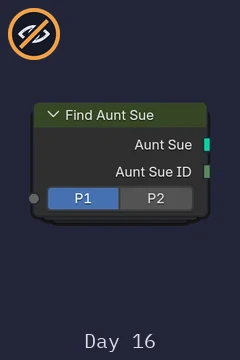
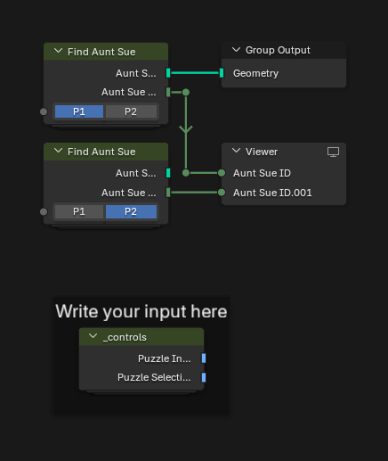
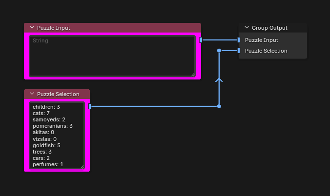
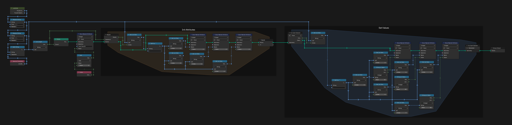
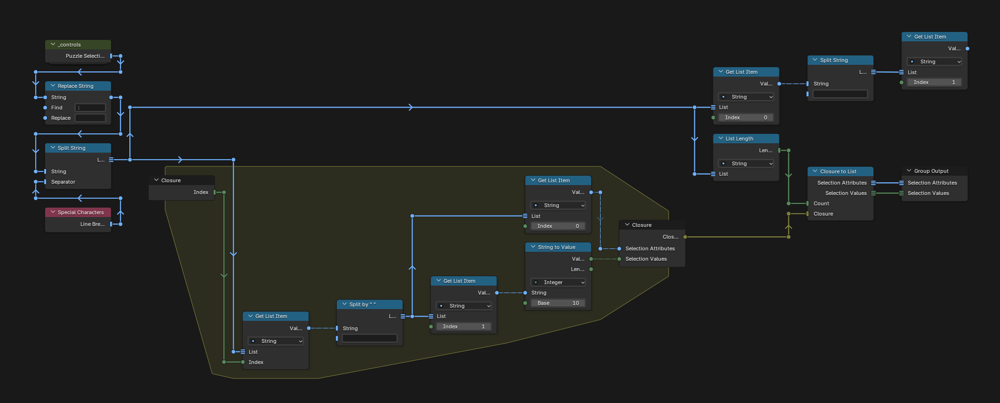
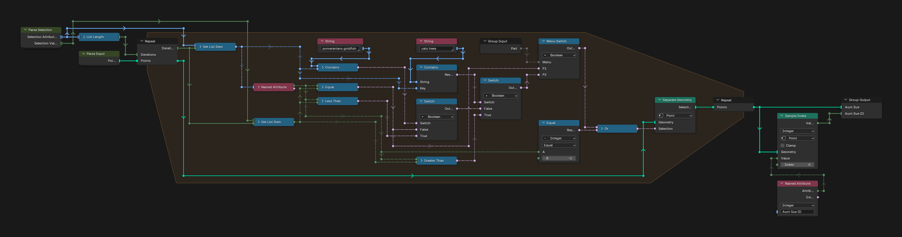

# Day 16: Aunt Sue

https://adventofcode.com/2015/day/16

**Part 1:** each of 500 aunts named Sue is listed with three things known about her, and a machine reading of the gift gives the exact amounts of ten compounds; find the only Sue whose listed things all match the reading.

**Part 2:** the same, but for cats and trees the reading is a lower bound (the Sue has more), and for pomeranians and goldfish an upper bound (she has fewer).

There is no visualization for this day, so the Find Aunt Sue node, as it appears in the main tree, is its only picture.

  

This puzzle was very simple with nodes. The only tricky part was setting every attribute to -1 at the start, for the compounds a Sue does not list. With the selection already parsed, it might have been better to skip the attributes that are not needed, but the current way is fast enough.

## Notes

- Paste your input into the "Puzzle Input" node inside the `_controls` group. The "Puzzle Selection" node holds the machine reading, the same for every input.
- The answers are in the Viewer: `Aunt Sue ID` (part 1) and `Aunt Sue ID.001` (part 2).

## Solution

### Day 16

The main tree runs Find Aunt Sue twice, once per part, and shows the ID of the Sue each one finds.

### _controls

`_controls` holds the puzzle input and the machine reading.

### Parse Input

Parse Input makes one point per Sue with her ID. The Init Attributes frame sets every compound of the reading to -1, unknown, and the Set Values frame stores the three compounds listed for each Sue.

### Parse Selection

Parse Selection turns the machine reading into two lists: the compound names and their amounts.

### Find Aunt Sue

Find Aunt Sue loops over the compounds of the reading and keeps the Sues whose value is unknown (-1) or matches. In part 1 a match means equal; in part 2 cats and trees must be greater, and pomeranians and goldfish less. It returns the Sues that are left and the ID of the first one.

