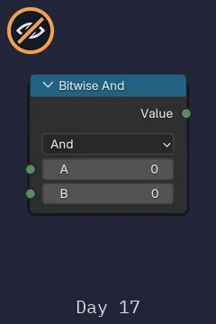
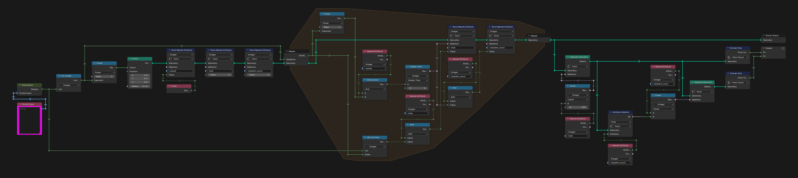
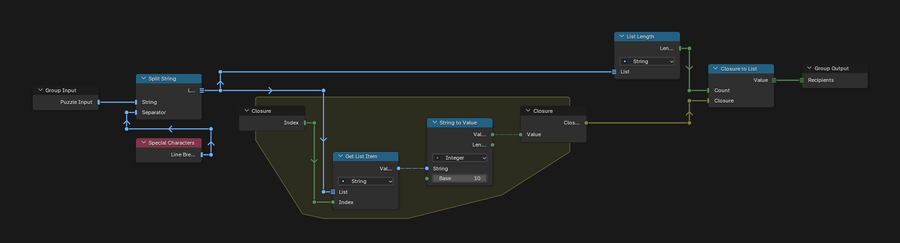

# Day 17: No Such Thing as Too Much

https://adventofcode.com/2015/day/17

**Part 1:** given the capacities of a set of containers, count the combinations of containers that hold exactly 150 liters.

**Part 2:** find the smallest number of containers that can hold exactly 150 liters, and count the combinations that use that many.

There is no visualization for this day, so the Bitwise And node, the heart of the solution, is its only picture.

  

Every combination is a point. Its index, written in binary, says which containers it uses: bit i is container i. A repeat zone goes over the containers, and each step works on all the combinations at once.

## Notes

- Paste your input into the "Puzzle Input" node of the main tree.
- The answers are in the Viewer: P1 and P2.

## Solution

### Day 17

The main tree makes 2 to the power of the number of containers points and stores each index as `subset`. For each container, the repeat zone checks its bit with Bitwise And and, if it is set, adds the capacity to `total` and 1 to `recipient_count`. Part 1 is the number of points with a total of 150; part 2 is how many of those have the lowest `recipient_count` (Attribute Statistic).

### Parse Input

Parse Input splits the input into lines and returns the list of capacities.

