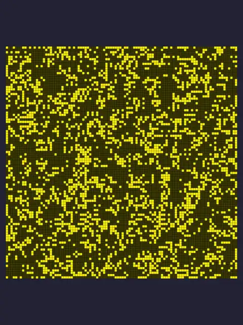
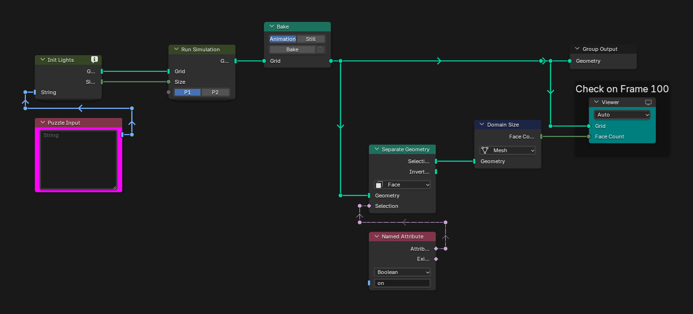
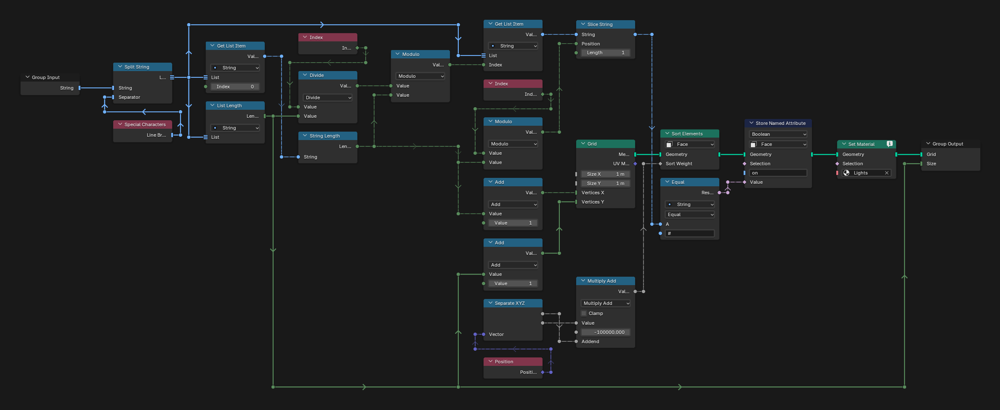
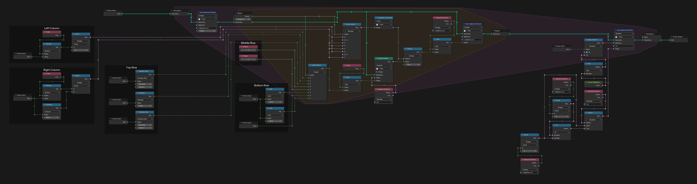
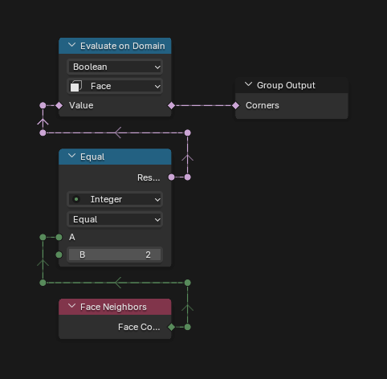
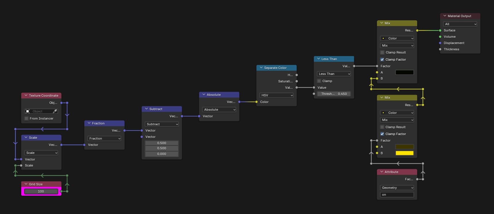
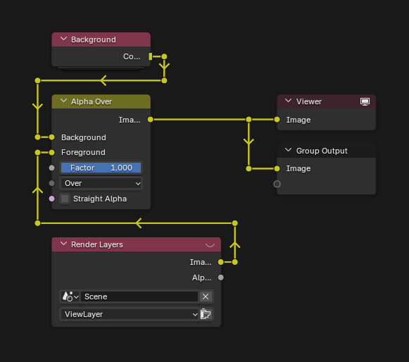
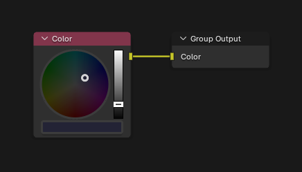

# Day 18: Like a GIF For Your Yard

https://adventofcode.com/2015/day/18

**Part 1:** a 100 by 100 grid of lights changes step by step like Conway's Game of Life: a light that is on stays on with 2 or 3 neighbours on, and a light that is off turns on with exactly 3; count the lights that are on after 100 steps.

**Part 2:** the same, but the four corner lights are always on.

In Run Simulation I got stuck for a while with the neighbour indices, and could not make it work until I saw that the left and right columns gave values that made no sense: their neighbours wrapped around to the other side of the grid. I changed those two with a Switch; the top and bottom rows had no problem. For the shading I used a box mask trick from a [short video](https://youtu.be/JYjYj8SMKKk) by [CMZW](https://www.youtube.com/@cmzwart) on YouTube, and other tricks from the same channel, such as Fraction then Subtract 0.5.

  

## Notes

- Paste the input into the "Puzzle Input" node, choose P1 or P2 in the Run Simulation node and press Bake in the Bake node.
- The animation has one step per frame, from frame 1 to 100 at 10 fps. On frame 100, the Viewer in the "Check on Frame 100" frame shows the answer as the face count of the lights that are on.
- The animation shows part 1. Part 2 looks almost the same, with the four corners always on.
- Init Lights does not turn the corners on: part 2 assumes they are already on in the input. If they are not, set them on in the input first.

## Solution

### Day 18

The main tree builds the grid in Init Lights, runs it in Run Simulation and bakes the animation. The "Check on Frame 100" frame counts the faces that are on.

### Init Lights

Init Lights makes one face per light with Grid, sorts the faces with Sort Elements so the indices go from left to right and from top to bottom, like the input, and stores `on` for every `#`.

### Run Simulation

Run Simulation moves the grid one step per frame in a simulation zone. A repeat zone goes over the eight neighbours: the Top Row, Middle Row and Bottom Row frames give the index offsets, and the Left Column and Right Column frames find the lights on the sides, where a Switch avoids the neighbours that would wrap around. `neighbors_on` counts the neighbours that are on, and the rules give the new `on`. In part 2, Corner Selection keeps the corners on.

### Corner Selection

Corner Selection finds the four corners: the only faces with two neighbours.

## Materials

### Lights

The box mask draws each light as a square with a dark border: the object coordinates scaled by the grid size, Fraction, Subtract 0.5 and Absolute give the distance to the centre of each cell, and Less Than cuts the square. The `on` attribute picks between the dark and the bright yellow.

## Compositor

### Compositor Nodes

### Background

