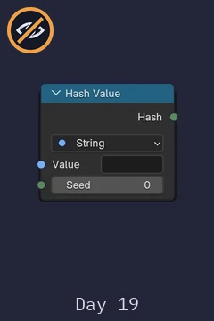
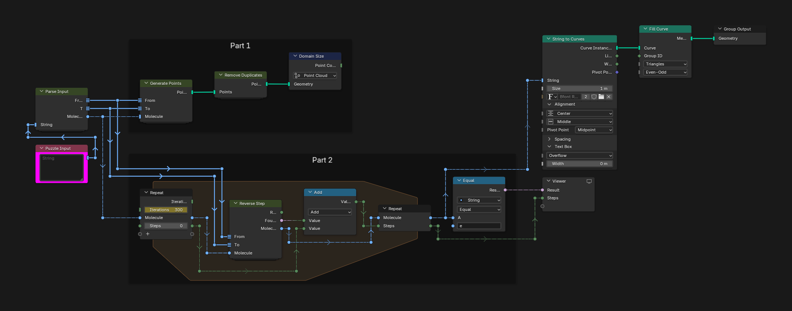
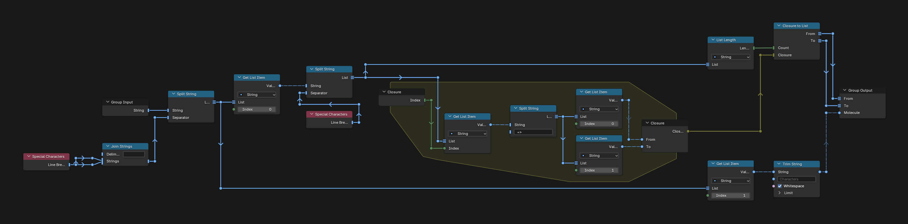
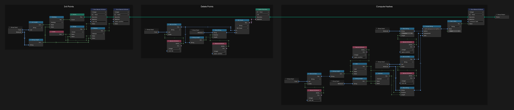
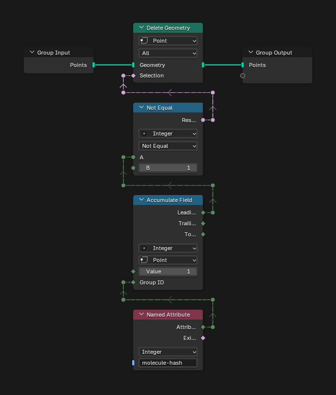
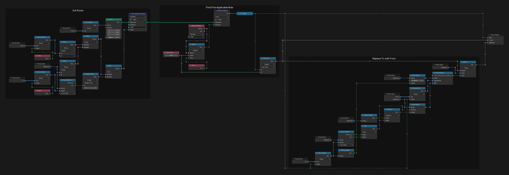

# Day 19: Medicine for Rudolph

https://adventofcode.com/2015/day/19

**Part 1:** given a list of replacement rules (one element becomes several) and a molecule, count the distinct molecules that one replacement can make.

**Part 2:** find the fewest replacements that build the molecule starting from a single `e`.

Part 2 is a greedy search backwards: each step undoes the first rule that fits and never goes back. A greedy search can get stuck on a molecule where no rule fits and that is not `e` yet, and then it would need to try the rules in another order. With the rules in the order they come in the input, it does not get stuck.

The new node for me this day was Hash Value, which turns any string into a number. It could have replaced the String to ID group I made for earlier days.

There is no visualization for this day, so the Hash Value node, the heart of part 1, is its only picture.

  

Blender cannot store strings in named attributes, but it can keep them in lists, and a list can be read with a field as the index. Part 1 makes a point for every place a rule fits and builds the new molecule on it; Hash Value turns each molecule into a number, so the repeated ones can be removed. Part 2 runs the search in a repeat zone, one rule per step, until only `e` is left.

## Notes

- Paste your input into the "Puzzle Input" node of the main tree.
- Part 1 is the Point Count of the Domain Size node in the "Part 1" frame. Part 2 is Steps in the Viewer, next to a check that the final molecule is `e`. The viewport shows the final molecule as text.
- If the search gets stuck with another input, the check in the Viewer is false and Steps is not the answer.
- The repeat zone runs 300 times. Once the molecule is `e` no rule fits, so the extra iterations change nothing. If the check is false and Steps is 300, raise the iterations.

## Solution

### Day 19

The main tree reads the input in Parse Input. The "Part 1" frame makes the new molecules and counts the distinct ones. The "Part 2" frame runs Reverse Step in a repeat zone and adds 1 to Steps each time a rule was undone.

### Parse Input

Parse Input splits the input into the rules and the molecule. A closure splits every rule at `=>`, and Closure to List gives the From and To lists.

### Generate Points

Generate Points makes one point for every rule and position in the molecule, and keeps the points where the rule's From is at that position. For each one, Format String builds the new molecule from the text before, the rule's To and the text after, and Hash Value stores it as `molecule-hash`.

### Remove Duplicates

Remove Duplicates keeps one point per `molecule-hash`: Accumulate Field, grouped by the hash, is 1 only on the first point of each group.

### Reverse Step

Reverse Step makes one point per rule and marks the rules whose To is in the molecule; a rule from `e` only counts when its To is the whole molecule. Attribute Statistic finds the first of them, and the molecule gets that rule's To replaced with its From.

