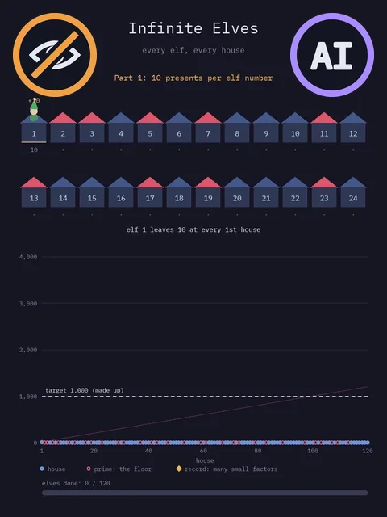
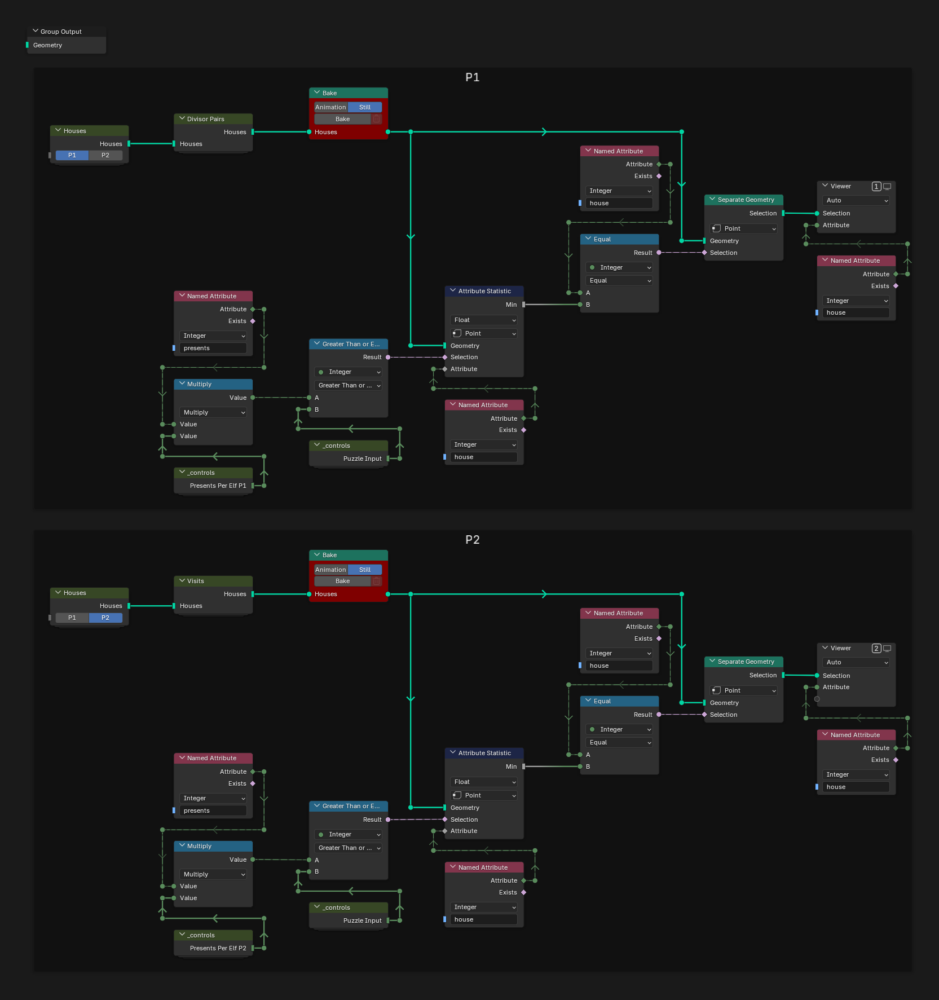
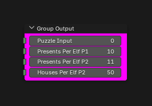
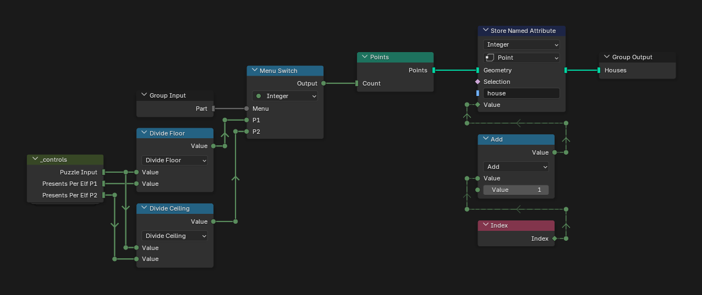
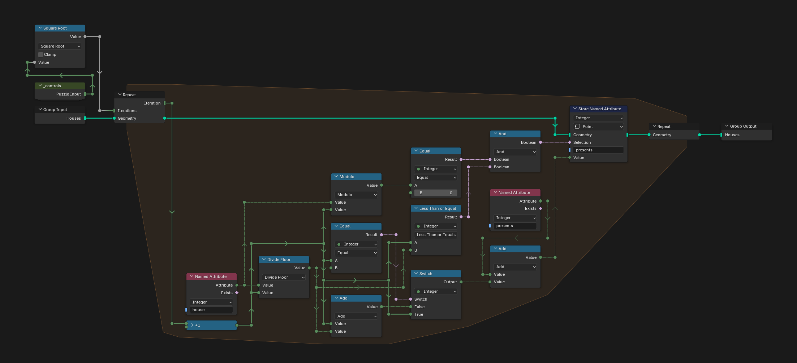
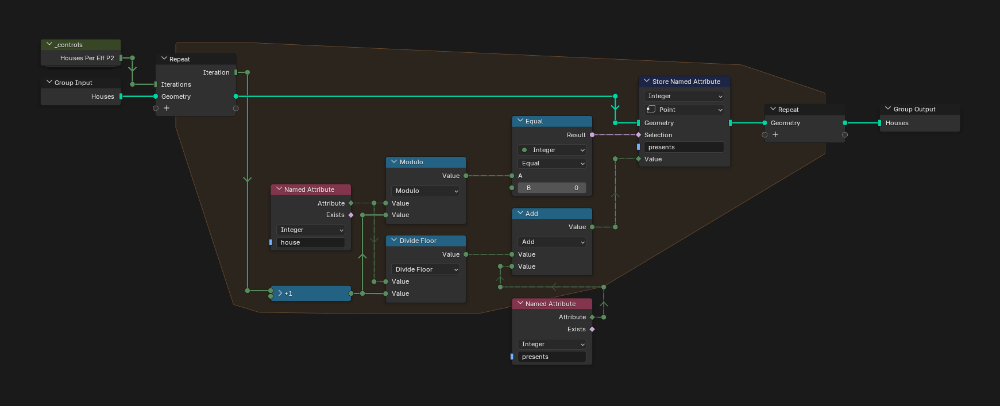
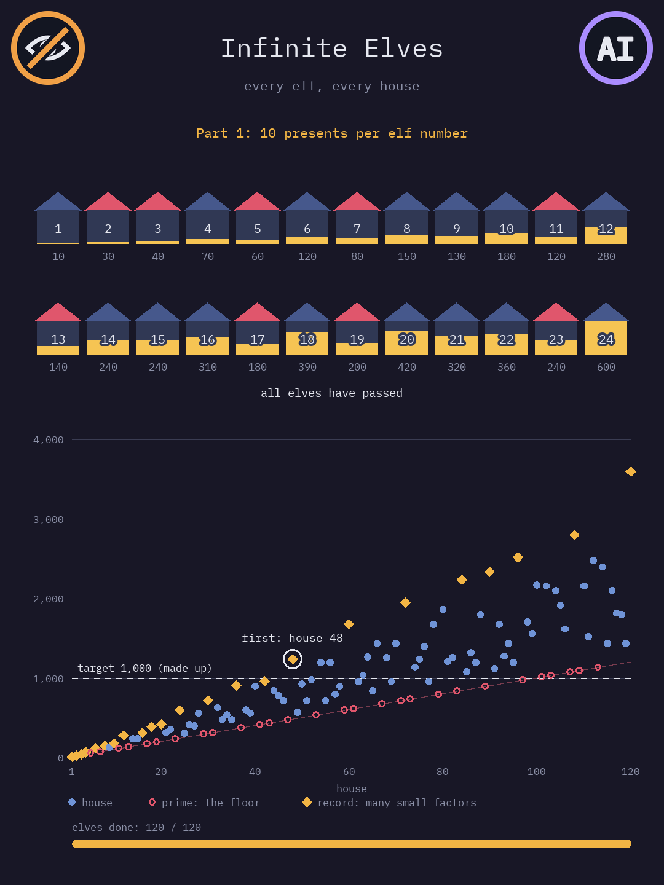

# Day 20: Infinite Elves and Infinite Houses

https://adventofcode.com/2015/day/20

**Part 1:** elf number n visits every n-th house and leaves ten times its number in presents, so each house gets ten times the sum of its divisors; find the lowest house that gets at least the puzzle input.

**Part 2:** the same, but each elf leaves eleven times its number and stops after 50 houses.

There is no visualization for this day, only an idea for one below. My first version had one repeat step per elf, and every step checked every house, which would never finish with millions of houses. Divisors come in pairs, d and house / d, so the final version only tries d up to the square root, and each step adds both numbers of the pair to every house at once. In part 2 an elf reaches a house on its visit number house / d, which is at most 50, so the loop goes over that visit number instead: 50 steps in all. I got stuck on this day and worked it out with AI explaining the maths.

   
  <em>Visualization idea, not built: made-up values, animated outside Blender</em>

## Notes

- Type the input in the "Puzzle Input" field of the Group Output inside the `_controls` group, then press Bake in both Bake nodes (Still). With millions of houses, the part 1 bake takes a while.
- The answers are in Viewer 1 (P1) and Viewer 2 (P2): the `house` attribute of the one point each shows, in the Spreadsheet.

## Solution

### Day 20

The main tree has one frame per part. Each one makes the houses, adds up the presents of every house (Divisor Pairs for part 1, Visits for part 2), bakes the result and finds the lowest house with at least the puzzle input in presents.

### _controls

`_controls` holds the puzzle input, the presents per elf of each part and the houses per elf of part 2.

### Houses

Houses makes one point per house, from 1 to the last house that is sure to get enough presents, with its number in `house`. In part 1 every house gets at least elf 1 and its own elf, ten times the house plus one, so the last house is the input divided by 10 (Divide Floor). In part 2 elf 1 stops early and only the house's own elf is sure, so it is the input divided by 11, rounded up (Divide Ceiling).

### Divisor Pairs

Divisor Pairs adds up the divisors of every house in `presents`. Each step of the repeat zone tries one d, up to the square root of the puzzle input, on all the houses at once: when d divides the house and is the smaller number of the pair, it adds d and house / d, or d alone for a square, so no pair is counted twice.

### Visits

Visits does the same for part 2. Each step is one visit number k, from 1 to 50: when k divides the house, elf house / k reached it on its k-th visit, and that elf's number is added to `presents`.

## Visualization idea

An idea for an animation, made with Python and made-up values (made with AI, not in Blender):

- A street with the first 24 houses. The first elves walk it house by house and leave their presents. The lit part of each house grows with its presents, and prime houses have a red roof.
- Below it, the presents of the first 120 houses. The primes stay on the bottom line, since only elf 1 and their own elf visit them, and the records are numbers with many small factors. A made-up target of 1,000 presents marks the first house that reaches it.
- Then part 2, with 11 presents per elf number and elves that stop after 10 houses instead of 50, so the limit shows on a short street: the first elves fall asleep along the way.

   
  <em>Part 1, then part 2 with elves that stop after 10 houses</em>

   
  <em>The end of part 1</em>

